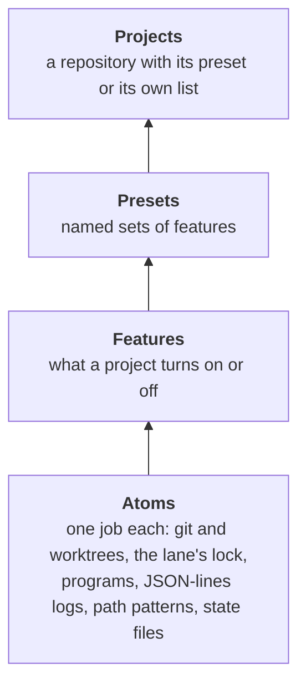

# Contributing to signalbox

Thank you for helping. signalbox is small on purpose: the Python standard library only, a
macOS tool installed with Homebrew, and behavior a person can predict from its documentation.

## Before you write code

- For a bug, open an issue: `signalbox --version`, and the output of `signalbox doctor` and
  `signalbox status` in the repository where it happens, say most of what is needed.
- For a new feature or a change of behavior, open an issue first and describe the problem
  it solves for someone running several Claude Code sessions in one repository.
- Security problems go through [SECURITY.md](SECURITY.md), not public issues.

## Working on the code

```sh
git clone https://github.com/alejandrovdev/signalbox.git
cd signalbox
python3 -m unittest discover -s tests -t .
python3 -m signalbox --help
```

Python 3.11 or later, nothing to install. The tests build temporary repositories with real
git, put a stub `gh` and a stub gate first on `PATH`, and stand in for `ps` and `lsof`: they
need no network, no GitHub account and no terminal of yours.

### Try a change apart from your install

The `SIGNALBOX_*` [environment variables](docs/configuration.md#environment-variables)
move the files signalbox keeps outside your repositories, so a rehearsal never touches your
own configuration, logs, caches or Claude Code settings:

```sh
scratch=$(mktemp -d)
export SIGNALBOX_CONFIG="$scratch/config.toml" SIGNALBOX_LOG_DIR="$scratch/logs" \
  SIGNALBOX_CACHE_DIR="$scratch/cache" SIGNALBOX_CLAUDE_SETTINGS="$scratch/settings.json" \
  SIGNALBOX_CLAUDE_PROJECTS="$scratch/projects" SIGNALBOX_SESSIONS_DIR="$scratch/sessions"
python3 -m signalbox doctor
```

The rehearsal is still real where it acts: `merge` merges on GitHub, and `sweep` removes
worktrees and branches of the repository you run it in.

### How the code is laid out

The package is built in layers. An atom knows nothing of features; a feature declares what
it needs and does nothing when it is off; presets name sets of features; a project picks a
preset or its own list. Keep a new piece in the lowest layer that can hold it.



| Where | What |
| --- | --- |
| `signalbox/atoms/` | the atoms: git, worktrees, the lane's lock, JSON-lines logs, path patterns, state files, finding programs |
| `signalbox/features/` | `board`, `brief` (`session-brief`), `lane` (`merge-lane`), `guard` (`merge-guard`), `sweep`, `metrics` |
| `signalbox/config.py` | the feature table, the presets and the configuration file |
| `signalbox/linking.py`, `answers.py`, `screens.py`, `ui/` | `setup`, `init`, `deinit`, `uninstall` and the terminal interface |
| `signalbox/hooks.py` | installing and removing the Claude Code hooks |
| `signalbox/cli.py`, `doctor.py`, `names.py`, `host.py`, `linked.py`, `repository.py` | the command line, the checks, every name the tool creates, the machine as the features see it, and which project a folder belongs to |

## How a change is made

- **Test first.** Write the test that shows the problem or the new rule, see it fail, then
  make it pass. Test through the public functions and assert every observable effect:
  output, exit code, files written, branches and worktrees left.
- **Keep what exists.** A change that touches a command or option others use keeps a test
  proving its old behavior still holds.
- **Docs travel with the code.** A new command, option, message or configuration key
  updates the help text, the README or `docs/`, and [CHANGELOG.md](CHANGELOG.md).
- **No dependencies.** Only the standard library, so Homebrew installs signalbox with its
  Python and nothing else.

## Commits and pull requests

- Commits follow [Conventional Commits](https://www.conventionalcommits.org/): `feat(sweep): ...`,
  `fix(merge-lane): ...`, `docs: ...`, written in English, in the imperative, saying what
  changes for the person using signalbox.
- One pull request per unit of behavior, with its tests and docs.
- Continuous integration runs the tests on macOS with Python 3.11 and 3.15; both must pass.
