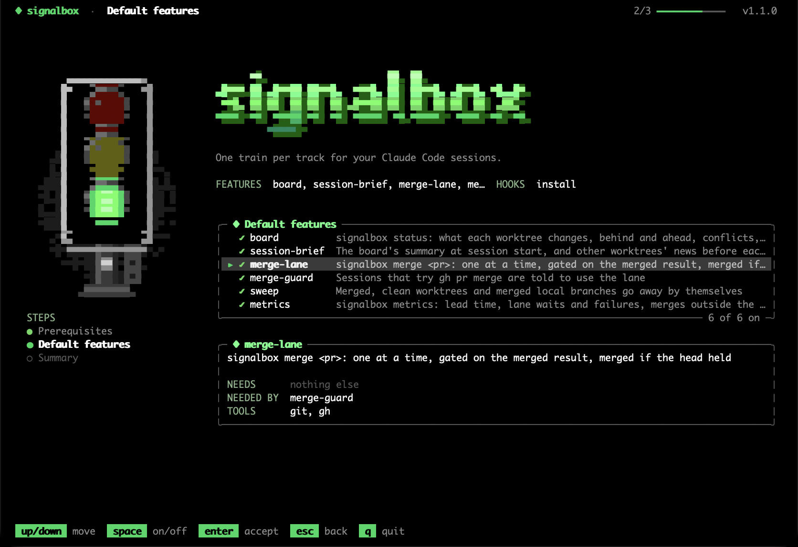
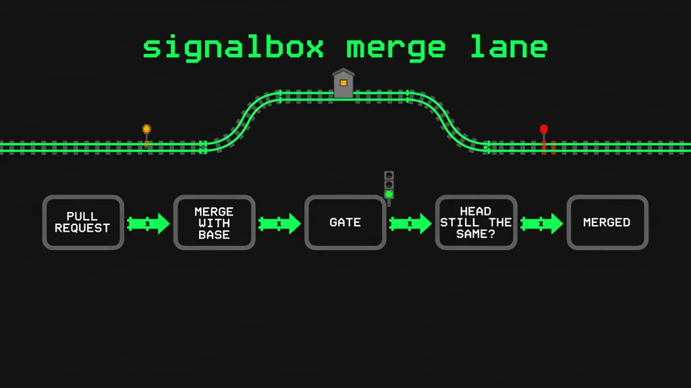
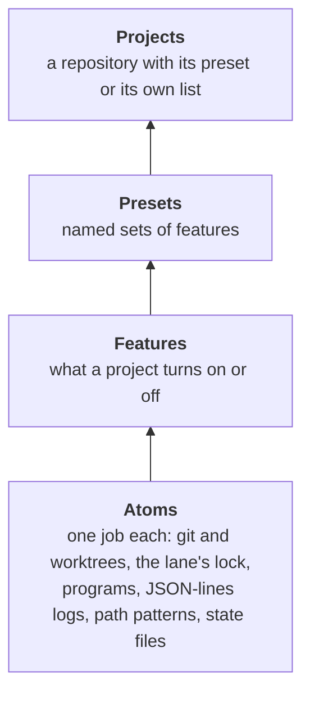

# signalbox


One train per track for your Claude Code sessions: signalbox lets several sessions work on
one repository at once, each in its own git worktree, without stepping on each other, and
merges their pull requests one at a time, each checked on the merged result.

> **Status: stable, private.** From 1.0.0, what [Compatibility](#compatibility) lists
> changes only in a major release; the [changelog](CHANGELOG.md) says what each release
> brings. The repository and its Homebrew tap are private until publication: `brew install`
> works only for a GitHub account with access to both.



Contents: [The problem it solves](#the-problem-it-solves) · [Requirements](#requirements) ·
[Install](#install) · [Quick start](#quick-start) ·
[Setting up and linking](#setting-up-and-linking) ·
[Features and presets](#features-and-presets) · [Configuration](#configuration) ·
[Commands](#commands) · [Compatibility](#compatibility) · [How it works](#how-it-works) ·
[Repositories that depend on each other](#repositories-that-depend-on-each-other) ·
[The merge guard](#the-merge-guard) · [Files it writes](#files-it-writes) ·
[Troubleshooting](#troubleshooting) · [Uninstall](#uninstall) · [Development](#development)

## The problem it solves

Several Claude Code sessions working on one repository at once, each in its own git
worktree, collide in ways none of them can see from where it stands:

| Without signalbox | With signalbox |
| --- | --- |
| Two sessions change the same file, and each finds out at merge time. | Every session starts with the board's summary: which worktrees change files, which of them share files with it; before each prompt, what changed since the last one. |
| A pull request passes its checks alone, then breaks the base once merged next to another one. | The merge lane runs the repository's own gate on the result of merging the pull request with the current base, one at a time, and merges only the head it checked. |
| A session runs `gh pr merge` and skips every check of the merged result. | The merge guard tells it to use the lane. |
| Merged worktrees and branches pile up, and nobody knows which are safe to remove. | The sweep removes clean worktrees whose branch was merged, and merged branches, sparing whatever is still in use. |
| A change spans an API and the apps that call it, and each repository is merged on its own. | A group shows the other repositories in each brief and merges their pull requests in dependency order. |
| Nobody can tell whether working in parallel pays. | Flow metrics: merges, stale merges, lane waits and failures, merges outside the lane. |

It installs once with Homebrew, is set up once from a terminal interface, and links any
number of repositories, each with only the features it needs.

## Requirements

- macOS with [Homebrew](https://brew.sh).
- Python 3.11 or later. The Homebrew formula installs and uses Homebrew's Python 3.15.
- git 2.38 or later (the board reads conflicts with `git merge-tree --write-tree`). git is
  looked for in your `PATH`, then in Homebrew's folder.
- [GitHub CLI](https://cli.github.com) (`gh`), signed in (`gh auth login`), for the merge
  lane and for the pull-request data of the board and the metrics. The repository's
  `origin` must be on GitHub for the merge lane.
- Claude Code, installed on its own, for the session brief and the merge guard: they run as
  Claude Code hooks.

## Install

```sh
brew install alejandrovdev/signalbox/signalbox
signalbox --version
```

The tap is `alejandrovdev/signalbox`. Installing adds the `signalbox` command and nothing
else: no hook is installed and no repository is touched until you run `signalbox setup` and
`signalbox init`.

While the repositories are private, Homebrew downloads them with `git`, which uses your own
GitHub credentials (for example `gh auth setup-git`).

## Quick start

1. Set up this Mac once. It checks the prerequisites, chooses the features new projects
   start from, and installs the Claude Code hooks in `~/.claude/settings.json`:

   ```sh
   signalbox setup
   ```

2. Link a repository. Go to its folder (the main checkout or any of its worktrees) and run
   `init`:

   ```sh
   cd ~/Projects/shop
   signalbox init
   ```

3. Look at the board:

   ```sh
   signalbox status
   ```

   ```text
   # Board of shop

   ## Worktrees

   | Branch | Feature documents | Behind | Ahead | Changed files | Conflicts with origin/main | Hours since last commit | Pull request |
   | --- | --- | --- | --- | --- | --- | --- | --- |
   | main |  | 0 | 0 | 0 | no | 3 |  |
   | fix-checkout |  | 2 | 3 | 4 | no | 1 | #41 |
   | add-coupons | coupons | 0 | 5 | 7 | yes | 0 | #42 |

   ## Shared files

   | Branch | File | Also changed by |
   | --- | --- | --- |
   | fix-checkout | src/cart.ts | add-coupons |
   | add-coupons | src/cart.ts | fix-checkout |

   ## Merge lane

   Lock: free.

   | Started | Pull request | Status | Wait (s) | Gate (s) | Attempts |
   | --- | --- | --- | --- | --- | --- |
   | 2026-11-24T16:02:11Z | 40 | merged | 0 | 212 | 1 |
   ```

4. Merge a pull request through the lane:

   ```sh
   signalbox merge 42
   ```

   The gate's output streams while it runs. On success the last line is
   `lane: #42 merged: main <commit> holds the checked tree <tree>.`, followed by what the
   sweep removed.

From then on, every Claude Code session you start in a worktree of `shop` gets the brief,
is told what changed in the other worktrees before each prompt, and is sent to the lane when
it tries `gh pr merge`.

## Setting up and linking

### What `setup` asks

1. **Prerequisites**: git (2.38 or later), gh signed in, Claude Code, and the Claude Code
   hooks, each marked `ok`, `missing`, `problem` or `unknown` with what to do about it. When
   git (missing, or older than 2.38), gh or Claude Code is missing and Homebrew is there, a
   warning closes the screen; without Homebrew nothing is offered, and the screen points to
   [brew.sh](https://brew.sh).
2. **Install what is missing** (only then): `Install with Homebrew` (`brew install git`,
   `brew install gh`, `brew install --cask claude-code`) or `Skip`, which it starts on.
   Nothing runs yet.
3. **Default features**: a checklist of the [features](#features-and-presets), starting
   from the defaults already saved, else from `recommended`. Turning one on turns on what it
   needs; turning one off turns off what needs it, and says why. At least one stays on.
4. **Summary**: what will be installed, the default features, where the hooks go (or `not installed (--no-hooks)`),
   and the projects already linked, which keep their own features. `Save these defaults?`:
   `y` saves; `n` changes nothing.

After the summary's `y`, the installs run first, with their output on screen; a failed
install is reported, the rest still runs, and `setup` exits with 1. Signing in stays yours:
`gh auth login` for gh, and `claude` once after Claude Code is installed. `--yes` alone
installs nothing; `--install-missing` installs. Then `setup` saves and installs the hooks in `~/.claude/settings.json` (unless `--no-hooks`),
keeping every other setting and hook of that file, and says `Next: in a repository's
folder, run: signalbox init`.

### What `init` asks

1. **Project name**: filled in from the folder's name. Lowercase letters, digits and
   hyphens, at most 32; numbered (`shop-2`) when another project has the name.
2. **Features**: start from the default features of `setup` (or `recommended` when none
   were saved); for a repository linked already, from its own.
3. **Gate**: asked only when the features include `merge-lane`. It starts from what the
   repository has, in this order: a `verify` or `check` script in `package.json` (run with
   `pnpm` when there is a `pnpm-lock.yaml`, `yarn` with a `yarn.lock`, else `npm run`), a
   `check` or `verify` target in a `Makefile` (`make check` or `make verify`), or `scripts/verify.sh`
   (`bash scripts/verify.sh`). With none of them, the field is empty and you type one.
4. **Summary**: the project, its folder, its base (`origin/<branch>`), its features and its
   gate. The question is `Link this repository?`, or `Replace its settings?` for a
   repository linked already (`Rename it?` when you changed its name).

The screens are drawn when your terminal can draw them: up and down move, Enter chooses or
accepts, Space turns a feature on or off, Esc goes back, `q` quits (Ctrl-C in a text field).
Otherwise they are plain questions: type the answer and press Enter, `<` goes back, `q` or
Ctrl-C quits. Quitting, or answering `n` at the summary, prints `Nothing was changed.` and
exits with 1.

### `signalbox init [folder]`

- Links the git repository a folder is in: the current folder, or the one you name. Run it
  in the main checkout or in any worktree: the project is always the repository's main
  checkout, and every worktree of the repository belongs to it, wherever the worktree is.
- Outside a git repository it refuses, with exit code 1:

  ```text
  ~/notes is not in a git repository: run git init in it first. Nothing was changed.
  ```

- In a repository linked already, it edits that project: the screens start from its current
  values, and the keys `init` does not ask (`gate_env`, `build_output` and the others) are
  kept. A new name renames the project.
- After saving it prints `Linked "shop" (<folder>) in <configuration file>.` When the
  project has `session-brief` or `merge-guard` and the hooks are not installed, it says to
  run `signalbox setup`.

Flags answer the screens beforehand, so `init` can run without asking anything:

```sh
signalbox init ~/Projects/shop --name shop --preset recommended --gate "pnpm verify" --yes
```

| Flag | Answers |
| --- | --- |
| `--name <name>` | the project's name |
| `--preset minimal\|recommended` or `--feature <feature>` | its features: a preset, or each feature with its own `--feature`, including the features each one needs |
| `--gate <command>` | the gate the merge lane runs |
| `--base <branch>` | the base branch (no screen asks for it; default: the branch `origin/HEAD` names, else `main`) |
| `--shared-hooks` | also write the hooks in the repository's `.claude/settings.json` (see [the hooks](docs/how-it-works.md#the-session-brief-and-the-hooks)) |
| `--yes` | every other screen takes the value it starts from, and the summary is confirmed |

Even with `--yes`, a screen with nothing to start from (a gate the repository does not
suggest, for example) is still asked. When nothing can be typed (no terminal, or the input
ended), the command stops with exit code 2 and names the flag:

```text
signalbox init: error: nothing answered "Gate": give --gate
```

A list of features that leaves out one they need is refused the same way:
`argument --feature: "merge-guard" needs "merge-lane"`.

### `signalbox setup`

`setup` changes only `[defaults]` (what new projects start from) and the hooks; linked
projects keep their own features.

| Flag | Answers |
| --- | --- |
| `--preset minimal\|recommended` or `--feature <feature>` | the default features |
| `--no-hooks` | do not install the hooks in `~/.claude/settings.json` |
| `--yes` | the prerequisites screen is passed, the features take what they start from, and the summary is confirmed |

```sh
signalbox setup --preset recommended --yes
```

### `signalbox deinit [folder]`

Unlinks the project of a folder (its main checkout or any worktree):

- removes the project from the configuration;
- removes the merge worktree signalbox made for it, unless a lane runs in it at that moment;
  a merge worktree you placed with `merge_worktree` is left, with the command that removes
  it;
- with `--shared-hooks`, removes the hooks `init --shared-hooks` wrote in the repository's
  `.claude/settings.json` (commit that file); without it, says that they stay;
- leaves as they are, and says so: its logs, the lane's lock and state and each worktree's
  `signalbox-changes.json` in the repository's git folder, and the Claude Code hooks, which
  do nothing in a repository no project links.

A folder that no project links is refused with exit code 1, and the linked projects are
listed. A project whose folder is gone is unlinked by naming that folder:
`signalbox deinit ~/Projects/old-shop`.

## Features and presets

| Feature | What you get | Needs |
| --- | --- | --- |
| `board` | `signalbox status`: what each worktree changes, behind and ahead, conflicts, shared files, the lane's lock and last runs | git 2.38+ |
| `session-brief` | The board's summary at session start, and the other worktrees' changes before each prompt | `board`, Claude Code |
| `merge-lane` | `signalbox merge <pr>`: one at a time, gated on the merged result, merged only if the head did not move | `gh` signed in, a gate, `origin` on GitHub |
| `merge-guard` | Sessions that try `gh pr merge` are told to use the lane | `merge-lane`, Claude Code |
| `sweep` | Merged, clean worktrees and merged local branches go away by themselves | git |
| `metrics` | `signalbox metrics`: lead time, lane waits and failures, merges outside the lane | `board`; `gh` for the pull-request section |

The presets are `minimal` (`board`, `sweep`) and `recommended` (all six). A project that
needs another set lists its features instead of naming a preset (`custom` in the screens is
simply your own checklist).

A feature that is off does nothing: its command refuses with the command that turns it on,
and its hooks stay silent.

```text
signalbox: The project "blog" does not have the merge-lane feature. Turn it on with: signalbox init ~/Projects/blog
```

## Configuration

One file, written by `setup` and `init` and editable by hand:

```text
~/Library/Application Support/signalbox/config.toml
```

Every command takes `--config <file>` (before or after its name) to use another one, and the
`SIGNALBOX_CONFIG` variable moves the default.

### One project

What `init` writes for a repository with a `Makefile` that has a `check` target:

```toml
[defaults]
preset = "recommended"

[projects.shop]
path = "~/Projects/shop"
preset = "recommended"
gate = "make check"
```

### Several projects

```toml
[defaults]
preset = "recommended"

[projects.shop]
path = "~/Projects/shop"
base = "main"
preset = "recommended"
gate = "pnpm install --frozen-lockfile && pnpm verify"
gate_env = { TEST_WORKERS = "4" }
gate_failed_step = 'FAILED at "(?P<step>[^"]+)"'
feature_docs = ["docs/features/*.md"]
build_output = ["node_modules", "dist", ".turbo", "coverage"]
merge_method = "squash"

[projects.blog]
path = "~/Projects/blog"
features = ["board", "sweep"]
```

Only `[defaults]` and `[projects.<name>]` tables may be at the top level.

### `[defaults]`

Optional. Projects do not inherit these values: they only fill in the screens of `init` for
a repository linked from then on.

| Key | Type | Rules |
| --- | --- | --- |
| `preset` | text | `minimal` or `recommended`. Not together with `features`. |
| `features` | list of text | Feature names, including the features each one needs. Not together with `preset`. |

### `[projects.<name>]`

The name has lowercase letters, digits and hyphens, starts with a letter or a digit, and is
at most 32 characters long.

| Key | Type | Required | Default and rules |
| --- | --- | --- | --- |
| `path` | text | yes | The repository's main checkout, absolute or starting with `~/`. `init` writes the full path. One project per folder. |
| `preset` | text | one of the two | `minimal` or `recommended`. |
| `features` | list of text | one of the two | At least one feature, including the features each one needs. |
| `base` | text | no | The base branch, as named on `origin`. Default: the branch `origin/HEAD` names (`git remote set-head origin --auto` records it), else `main`. In a repository with no remote at all, the local branch of that name is the base: the board, the brief, the sweep and the metrics work against it; the merge lane needs `origin` on GitHub. |
| `gate` | text | with `merge-lane` | The command the merge lane runs in the merge worktree; it passes with exit code 0. Not empty. |
| `gate_env` | table of text | no | Variables added to the gate's environment, for example `{ TEST_WORKERS = "4" }`. Each name is a shell variable name. |
| `gate_failed_step` | text | no | A regular expression with a group named `step`, read from a failed gate's output. The last match names the step that failed, in the lane's message, the commit status and the log. |
| `feature_docs` | list of text | no | Patterns of feature documents. Default: none. The board and the brief show, for each branch, the changed files that match (by name, without extension); the metrics count them as documentation. |
| `build_output` | list of text | no | Ignored paths a new worktree builds again: the sweep removes a merged worktree whose ignored files all match. Default: `.DS_Store`, `__pycache__`, `*.pyc`, `.pytest_cache`, `node_modules`, `dist`, `build`, `coverage`, `.next`, `.turbo`, `.astro`, `*.tsbuildinfo`. Giving the key replaces that list: repeat what you still want. |
| `merge_method` | text | no | How the lane merges on GitHub: `merge` (the default), `squash` or `rebase`. |
| `merge_worktree` | text | no | Where the lane merges. Default: `~/Library/Caches/signalbox/<project>/merge.noindex`. |
| `gate_files` | list of text | no | Patterns of files whose change counts as a change to the gate (see [the gate-change check](docs/how-it-works.md#the-merge-lane)), besides those the gate command shows. Default: none. |
| `legacy_locks` | list of text | no | Lock files of another merge tool in the repository's git folder, which the lane takes too, so the two never run at once while you move from one to the other. Default: none. |

In patterns (`feature_docs`, `build_output`), `*` and `?` stay within one folder and `**`
crosses folders. A pattern with no slash matches a name anywhere (`node_modules`,
`*.tsbuildinfo`); one with a slash matches the path from the worktree's top
(`docs/features/*.md`).

### `[groups.<name>]`

Repositories that depend on each other (an API and the apps that call it, say) form a group:

```toml
[groups.platform]
projects = ["api", "web", "mobile"]
```

`projects` names linked projects in dependency order: a project merges after those before it.
A group's name follows the project-name rule; a group names at least two projects, and a
project is in one group at most. `init` renames a project inside its group too; `deinit`
takes it out of its group and removes a group left with fewer than two, and says so. See
[Repositories that depend on each other](#repositories-that-depend-on-each-other).

### After you edit the file

Every command, and every hook, reads the file each time it runs: there is nothing to reload
or restart. Unknown keys are errors. A command that reads the file reports each problem by
its key, one per line, and exits with 1:

```text
~/Library/Application Support/signalbox/config.toml: projects.Blog: a project's name has lowercase letters, digits and hyphens, at most 32
~/Library/Application Support/signalbox/config.toml: projects.web.features: "merge-guard" needs "merge-lane"
~/Library/Application Support/signalbox/config.toml: projects.web.merge_method: unknown method "fast"; one of: merge, squash, rebase
~/Library/Application Support/signalbox/config.toml: projects.web.colour: unknown key
```

Reading the file checks its shape only. Whether a folder exists, the base is on `origin` or
a tool is installed is what `signalbox doctor` checks: run it after an edit. When you turn on
`session-brief` or `merge-guard` by hand, check that the hooks are installed (`doctor` says;
`signalbox setup` installs them).

## Commands

Every command takes `--config <file>` and `-h` or `--help`. `signalbox --version` prints the
version. A command about a repository runs in any folder of it (the main checkout or any
worktree); outside a linked repository it says how to link one:

```text
signalbox: ~/notes is in no linked project. Link its repository with: signalbox init
```

| Command | Flags | What it does |
| --- | --- | --- |
| `setup` | `--preset <name>` or `--feature <feature>` (repeated), `--no-hooks`, `--install-missing`, `--yes` | Set up once: check the prerequisites (and install what is missing with Homebrew, when chosen), choose the defaults, install the Claude Code hooks. |
| `init [folder]` | `--name <name>`, `--gate <command>`, `--base <branch>`, `--shared-hooks`, `--preset <name>` or `--feature <feature>` (repeated), `--yes` | Link a repository's folder, or replace the settings of one linked already. |
| `deinit [folder]` | | Unlink a repository's folder. |
| `status` | `--json`, `--no-github`, `--group` | Show the board. `--no-github` leaves out the open pull requests (no `gh`); `--group` shows the board of every project of this project's group, in order. |
| `brief` | | Print what the session-start hook tells a session. |
| `changes` | | Print what changed in the other worktrees since the last run in this worktree. |
| `sweep` | `--dry-run`, `--json`, `--background` | Remove merged, clean worktrees and merged local branches. `--dry-run` says what it would do and changes nothing; `--background` starts it detached, prints nothing and exits 0, passing the other flags on. |
| `merge <pr> [<project>#<pr> ...]` | `--dry-run`, `--allow-gate-change` | Merge a pull request through the lane; with `<project>#<pr>`, several pull requests of one group, in the group's order. `--dry-run` merges and runs the gate in the merge worktree, then stops; `--allow-gate-change` runs a pull request that changes the gate's own files. |
| `metrics` | `--since <YYYY-MM-DD>`, `--until <YYYY-MM-DD>`, `--json`, `--no-github` | Print flow metrics. `--since`: the first local day (default: 14 days ago); `--until`: the local day the window ends at, excluded (default: now). |
| `doctor` | | Check what signalbox and each project need on this Mac. |
| `hook <event>` | `--shared` | What Claude Code's hooks run: `session-start`, `user-prompt-submit` or `pre-tool-use`, with the hook's JSON on standard input. |
| `uninstall` | `--purge` | Remove the Claude Code hooks; with `--purge`, also the configuration, the logs, the merge worktrees and the sessions' records. |

You do not need to type `hook`: Claude Code runs it.

| Exit code | Meaning |
| --- | --- |
| 0 | It did what was asked. `merge --dry-run`: the pull request was checked and nothing was merged. |
| 1 | It refused, or something needs attention: the folder is in no linked project or the feature is off, the configuration has problems, the base is not on `origin`, a check of `doctor` failed, the lane did not merge, or you quit a screen. |
| 2 | The command line is wrong, including a screen no flag answered when nothing can be typed. For `hook pre-tool-use`: the merge guard refused the command. |
| 130, 143 | `merge` was stopped (Ctrl-C, or `SIGTERM`). |

`brief`, `changes` and `hook` exit with 0 whatever happens (only the guard's refusal exits
with 2): a hook must never block a session by failing. Outside a linked repository, or with
the feature off, they print nothing.

`status --json`, `sweep --json` and `metrics --json` print one JSON object with the same
facts as the Markdown output.

## Compatibility

From 1.0.0, signalbox follows [Semantic Versioning](https://semver.org): a minor or patch
release keeps working with whatever you built on the following, and only a major release
changes them, with the [changelog](CHANGELOG.md) saying how to move:

- the commands, their options and what they do, and the exit codes: 0 when a command did
  what was asked, 1 when it refused or something needs attention, 2 when the command line
  is wrong;
- the configuration file: where it is, its keys and what they mean (a minor release may add
  an optional key);
- the lane log's fields and statuses, the JSON of `status`, `sweep` and `metrics` with
  `--json` (a minor release may add a key);
- the files and folders signalbox writes, and the `SIGNALBOX_*` environment variables this
  README names.

Not part of it: `signalbox hook`, which Claude Code's hooks call; the wording and layout of
what the commands print without `--json` (read it, do not parse it); and the look of the
setup screens.

## How it works



signalbox keeps no service running: each command, and each Claude Code hook, reads the
configuration file and git, does its work and ends. The board and the brief never fetch;
the merge lane fetches what it merges. The merge lane, step by step with a diagram, the
sweep's rules, what the hooks tell a session, and how to read the flow metrics are in
[How signalbox works](docs/how-it-works.md).

## Repositories that depend on each other

One change often spans several repositories: a field the API adds and the app shows. Link
each repository as its own project (each with its base and gate), then name them in a
[`[groups.<name>]`](#groupsname) table, in dependency order. The group adds three things.

**The brief reaches across the group.** After this repository's lines, a session also reads
`Other repositories of <group>:` and one line per worktree of the other repositories that
changes files (`- api: add-coupons; features: coupons`), each measured against its own
project's base, git only. A repository of the group that cannot be read is left out. Within
the brief's 2,000 characters this repository's lines come first: the group's are cut first.

**One board for the group.** `signalbox status --group` prints the board of every project of
the group, in order (`--json`: `{"group": ..., "projects": [{"project": ..., ...}]}`; a
project that cannot be read is named, and the exit code is 1).

**A merge in order.** Name the pull requests of the change, a bare number for this folder's
repository and `<project>#<number>` for the others:

```sh
signalbox merge 25 api#27
```

```text
group: merging in order: api#27, web#25; what merges stays merged if a later one fails.
...
group: api#27 merged
group: web#25 merged
```

Every pull request is read first: when any would be refused (closed, a draft, on another
base, from a fork, unreadable, or changing its own gate without `--allow-gate-change`), each
is named and nothing runs. Then the lanes run one after
another in the group's order (not the command line's), each in its own repository with its
own lock, gate and lane log (its record says `"group"`), and the run stops at the first that
does not merge: the closing lines say `merged`, `not merged (<status>)` or `not tried`. The
exit code is 0 only when all merged. `--dry-run` and `--allow-gate-change` apply to each.

What it cannot do: merge atomically across repositories. What merged stays merged when a
later pull request fails its gate; fix that one and run its merge again. A dry run checks
each repository against its own base, which does not hold the earlier repositories' change.
Put options before or after the pull requests, not between them.

## The merge guard

With `merge-guard`, the `pre-tool-use` hook reads each command a session is about to run in
Bash and refuses a merge that skips the lane. The session is told:

```text
Merge through the lane: signalbox merge 42. A direct gh pr merge skips the check of the merged result.
```

What it refuses:

- `gh pr merge`, also with `gh`'s own `-R` or `--repo` before `pr`;
- a call to GitHub's API with `PUT` on `pulls/<number>/merge`, through `gh api`, `curl` or
  `wget`;
- either one after `&&`, `;`, `|`, a newline, `env` or variable assignments, `timeout`, or
  inside `bash -c '...'`.

What passes: the same words inside a quoted argument (a commit message, a search pattern, an
`echo`), `gh pr merge --help`, and a `GET` of `pulls/<number>/merge`, which only asks.

**It is guidance, not a security boundary.** It reads commands as the shell splits them and
cannot run them, so `xargs`, `eval`, a GraphQL mutation, a `gh` alias or an interpreter
(`python3 -c`, `node -e`) get around it. It sees only the commands of Claude Code sessions
in a linked repository: a merge from GitHub's website or from your own terminal is not seen.
The metrics count such merges as `Outside the merge lane`. A hook that refuses (exit 2)
stops the call in every permission mode.

## Files it writes

| Where | What |
| --- | --- |
| `~/Library/Application Support/signalbox/config.toml` | the configuration; the folder holds a `.signalbox` file that marks it as signalbox's |
| `~/Library/Application Support/signalbox/sessions/<session id>.json` | where each Claude Code session stands, written by the hooks (see [the sweep](docs/how-it-works.md#the-sweep)) |
| `~/Library/Logs/signalbox/<project>/lane.jsonl` | the lane log, one JSON line per run |
| `~/Library/Logs/signalbox/<project>/gates/` | the whole output of each failed gate |
| `~/Library/Caches/signalbox/<project>/merge.noindex` | the merge worktree (unless `merge_worktree` places it) |
| `~/.claude/settings.json` | the three user-level hooks (`setup`) |
| `<repository>/.claude/settings.json` | the shared hooks, only with `init --shared-hooks` |

In each linked repository's git folder (`git rev-parse --git-common-dir`, usually `.git`):

| File | What |
| --- | --- |
| `signalbox-lane.lock` | the lane's lock: one run at a time across all worktrees |
| `signalbox-lane.json` | the pid of the gate a run is running, removed when it ends; how the next run finds a gate a killed run left |
| `signalbox-changes.json`, in each worktree's own git folder | what `changes` last saw in that worktree |
| `worktrees/merge.noindex/` | git's record of the merge worktree, as for any worktree |

On GitHub, the lane posts the commit status `signalbox/merge-lane` on each head it checks,
and merges through `gh`. Apart from these files and what the sweep removes, nothing is
written into your repositories, and no branch is ever deleted on GitHub.

## Troubleshooting

Start with `signalbox doctor`: it checks the prerequisites and every linked project, and
says what to do about each problem. Common cases (the lock is busy, `no such ref`, a head
that moved, a gate that changes itself, a worktree that is not swept, sessions without a
brief) are in [Troubleshooting signalbox](docs/troubleshooting.md).

## Uninstall

1. Unlink each repository, if you want to do it project by project:

   ```sh
   cd ~/Projects/shop
   signalbox deinit
   ```

2. Remove the hooks from `~/.claude/settings.json`:

   ```sh
   signalbox uninstall
   ```

   The configuration, the logs and the merge worktrees are kept, and it says where.
   `signalbox uninstall --purge` removes them too: the merge worktrees signalbox made, the
   logs folder, the caches folder, the sessions' records and the configuration file. It refuses, and changes
   nothing, while a merge lane runs in a linked repository.

3. Remove the command and the tap. Do this after `signalbox uninstall`: the hooks run the
   installed command.

   ```sh
   brew uninstall signalbox
   brew untap alejandrovdev/signalbox
   ```

Left in place: the lane's lock and state and each worktree's `signalbox-changes.json` in
each repository's git folder, the shared hooks a repository's `.claude/settings.json` holds
(`signalbox deinit --shared-hooks` removes them; commit that file), and a merge worktree placed with
`merge_worktree` (`uninstall --purge` prints the command that removes it).

## Development

```sh
python3 -m unittest discover -s tests -t .
```

The code uses the Python standard library only (Python 3.11 or later). The tests build
temporary repositories with real git, put a stub `gh` and a stub gate on a scratch `PATH`,
and stand in for `ps` and `lsof`: they need no network and no GitHub account.

The package is built in layers. An atom knows nothing of features; a feature declares what
it needs and does nothing when it is off; presets name sets of features; a project picks a
preset or its own list.



| Where | What |
| --- | --- |
| `signalbox/atoms/` | the atoms: git, worktrees, the lane's lock, JSON-lines logs, path patterns, state files, finding programs |
| `signalbox/features/` | `board`, `brief` (`session-brief`), `lane` (`merge-lane`), `guard` (`merge-guard`), `sweep`, `metrics` |
| `signalbox/config.py` | the feature table, the presets and the configuration file |
| `signalbox/linking.py`, `answers.py`, `screens.py`, `ui/` | `setup`, `init`, `deinit`, `uninstall` and the terminal interface |
| `signalbox/hooks.py` | installing and removing the Claude Code hooks |
| `signalbox/cli.py`, `doctor.py`, `names.py`, `host.py`, `linked.py`, `repository.py` | the command line, the checks, every name the tool creates, the machine as the features see it, and which project a folder belongs to |

### A rehearsal apart from a real install

These variables move the files signalbox keeps outside your repositories, so a rehearsal
never touches your own configuration, logs, caches or Claude Code settings:

| Variable | Default |
| --- | --- |
| `SIGNALBOX_CONFIG` | `~/Library/Application Support/signalbox/config.toml` |
| `SIGNALBOX_LOG_DIR` | `~/Library/Logs/signalbox` |
| `SIGNALBOX_CACHE_DIR` | `~/Library/Caches/signalbox`, where the merge worktrees go |
| `SIGNALBOX_CLAUDE_SETTINGS` | `~/.claude/settings.json`, where the hooks go |
| `SIGNALBOX_CLAUDE_PROJECTS` | `~/.claude/projects`, where the sweep reads Claude Code's agent records |
| `SIGNALBOX_SESSIONS_DIR` | `~/Library/Application Support/signalbox/sessions`, where the hooks record each session |
| `SIGNALBOX_GIT`, `SIGNALBOX_GH`, `SIGNALBOX_CLAUDE`, `SIGNALBOX_BREW` | the program found in `PATH` or Homebrew's folders (a path to no program counts as missing) |

```sh
scratch=$(mktemp -d)
export SIGNALBOX_CONFIG="$scratch/config.toml" SIGNALBOX_LOG_DIR="$scratch/logs" \
  SIGNALBOX_CACHE_DIR="$scratch/cache" SIGNALBOX_CLAUDE_SETTINGS="$scratch/settings.json" \
  SIGNALBOX_CLAUDE_PROJECTS="$scratch/projects" SIGNALBOX_SESSIONS_DIR="$scratch/sessions"
python3 -m signalbox doctor
```

The rehearsal is still real where it acts: `merge` merges on GitHub, and `sweep` removes
worktrees and branches of the repository you run it in.
