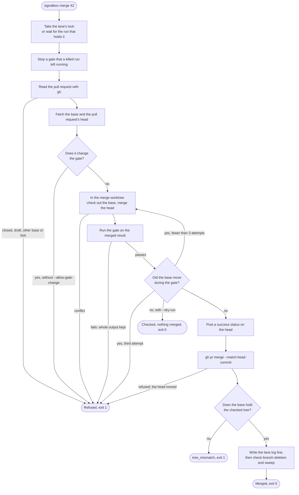
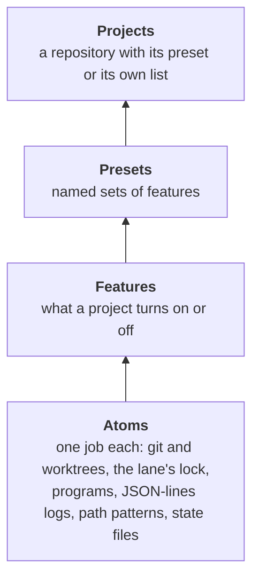

# signalbox

Lanes for parallel Claude Code sessions that work in git worktrees of one repository.

> **Status: in development.** The repository and its Homebrew tap are private until
> publication: `brew install` works only for a GitHub account with access to both. Commands
> and files may still change before the first public release.

Contents: [What it does](#what-it-does) · [Requirements](#requirements) ·
[Install](#install) · [Quick start](#quick-start) ·
[Setting up and linking](#setting-up-and-linking) ·
[Features and presets](#features-and-presets) · [Configuration](#configuration) ·
[Commands](#commands) · [The merge lane](#the-merge-lane) · [The sweep](#the-sweep) ·
[The session brief and the hooks](#the-session-brief-and-the-hooks) ·
[The merge guard](#the-merge-guard) · [Flow metrics](#flow-metrics) ·
[Files it writes](#files-it-writes) · [Troubleshooting](#troubleshooting) ·
[Uninstall](#uninstall) · [Development](#development)

## What it does

When several Claude Code sessions work on one repository at once, each in its own git
worktree, they step on each other: two of them change the same file, a branch falls behind
the base, a pull request passes its checks alone and breaks the base once merged next to
another one, and merged worktrees pile up.

A railway signal box sets which train enters which track, keeps two trains off one track,
and lets one through at a time. signalbox does the same for the sessions of a repository:

- **Board**: what every worktree changes, how far each is from the base branch, whether it
  conflicts with it, which files two worktrees change at once, whether the merge lane is busy.
- **Session brief**: at every session start, the board's summary reaches the session; before
  every prompt, what changed in the other worktrees since the last one.
- **Merge lane**: one pull request at a time, checked by the repository's own gate on the
  result of merging it with the current base, then merged only if its head did not move.
- **Merge guard**: sessions that try a direct `gh pr merge` are told to use the lane.
- **Sweep**: clean worktrees whose branch was merged, and merged local branches, go away.
- **Flow metrics**: lead time, lane waits and failures, merges outside the lane.

It installs once with Homebrew, is set up once from a terminal interface, and links any
number of repositories, each with only the features it needs. It is for one person (or a
team) running Claude Code sessions side by side in one repository hosted on GitHub.

## Requirements

- macOS with [Homebrew](https://brew.sh).
- Python 3.11 or later. The Homebrew formula installs and uses Homebrew's Python 3.15.
- git 2.38 or later (the board reads conflicts with `git merge-tree --write-tree`). git is
  looked for in your `PATH`, then in Homebrew's folder.
- [GitHub CLI](https://cli.github.com) (`gh`), signed in (`gh auth login`), for the merge
  lane and for the pull-request data of the board and the metrics. The repository's
  `origin` must be on GitHub for the merge lane.
- Claude Code, installed on its own, for the session brief and the merge guard: they run as
  Claude Code hooks.

## Install

```sh
brew install alejandrovdev/signalbox/signalbox
signalbox --version
```

The tap is `alejandrovdev/signalbox`. Installing adds the `signalbox` command and nothing
else: no hook is installed and no repository is touched until you run `signalbox setup` and
`signalbox init`.

While the repositories are private, Homebrew downloads them with `git`, which uses your own
GitHub credentials (for example `gh auth setup-git`).

## Quick start

1. Set up this Mac once. It checks the prerequisites, chooses the features new projects
   start from, and installs the Claude Code hooks in `~/.claude/settings.json`:

   ```sh
   signalbox setup
   ```

2. Link a repository. Go to its folder (the main checkout or any of its worktrees) and run
   `init`:

   ```sh
   cd ~/Projects/shop
   signalbox init
   ```

3. Look at the board:

   ```sh
   signalbox status
   ```

   ```text
   # Board of shop

   ## Worktrees

   | Branch | Feature documents | Behind | Ahead | Changed files | Conflicts with origin/main | Hours since last commit | Pull request |
   | --- | --- | --- | --- | --- | --- | --- | --- |
   | main |  | 0 | 0 | 0 | no | 3 |  |
   | fix-checkout |  | 2 | 3 | 4 | no | 1 | #41 |
   | add-coupons | coupons | 0 | 5 | 7 | yes | 0 | #42 |

   ## Shared files

   | Branch | File | Also changed by |
   | --- | --- | --- |
   | fix-checkout | src/cart.ts | add-coupons |
   | add-coupons | src/cart.ts | fix-checkout |

   ## Merge lane

   Lock: free.

   | Started | Pull request | Status | Wait (s) | Gate (s) | Attempts |
   | --- | --- | --- | --- | --- | --- |
   | 2026-11-24T16:02:11Z | 40 | merged | 0 | 212 | 1 |
   ```

4. Merge a pull request through the lane:

   ```sh
   signalbox merge 42
   ```

   The gate's output streams while it runs. On success the last line is
   `lane: #42 merged: main <commit> holds the checked tree <tree>.`, followed by what the
   sweep removed.

From then on, every Claude Code session you start in a worktree of `shop` gets the brief,
is told what changed in the other worktrees before each prompt, and is sent to the lane when
it tries `gh pr merge`.

## Setting up and linking

### What `setup` asks

1. **Prerequisites**: git (2.38 or later), gh signed in, Claude Code, and the Claude Code
   hooks, each marked `ok`, `missing`, `problem` or `unknown` with what to do about it.
   Nothing is installed from here.
2. **Default features**: a checklist of the [features](#features-and-presets), starting
   from the defaults already saved, else from `recommended`. Turning one on turns on what it
   needs; turning one off turns off what needs it, and says why. At least one stays on.
3. **Summary**: the default features, where the hooks go (or `not installed (--no-hooks)`),
   and the projects already linked, which keep their own features. `Save these defaults?`:
   `y` saves; `n` changes nothing.

After saving, `setup` installs the hooks in `~/.claude/settings.json` (unless `--no-hooks`),
keeping every other setting and hook of that file, and says `Next: in a repository's
folder, run: signalbox init`.

### What `init` asks

1. **Project name**: filled in from the folder's name. Lowercase letters, digits and
   hyphens, at most 32; numbered (`shop-2`) when another project has the name.
2. **Features**: start from the default features of `setup` (or `recommended` when none
   were saved); for a repository linked already, from its own.
3. **Gate**: asked only when the features include `merge-lane`. It starts from what the
   repository has, in this order: a `verify` or `check` script in `package.json` (run with
   `pnpm` when there is a `pnpm-lock.yaml`, `yarn` with a `yarn.lock`, else `npm run`), a
   `check` or `verify` target in a `Makefile` (`make check` or `make verify`), or `scripts/verify.sh`
   (`bash scripts/verify.sh`). With none of them, the field is empty and you type one.
4. **Summary**: the project, its folder, its base (`origin/<branch>`), its features and its
   gate. The question is `Link this repository?`, or `Replace its settings?` for a
   repository linked already (`Rename it?` when you changed its name).

The screens are drawn when your terminal can draw them: up and down move, Enter chooses or
accepts, Space turns a feature on or off, Esc goes back, `q` quits (Ctrl-C in a text field).
Otherwise they are plain questions: type the answer and press Enter, `<` goes back, `q` or
Ctrl-C quits. Quitting, or answering `n` at the summary, prints `Nothing was changed.` and
exits with 1.

### `signalbox init [folder]`

- Links the git repository a folder is in: the current folder, or the one you name. Run it
  in the main checkout or in any worktree: the project is always the repository's main
  checkout, and every worktree of the repository belongs to it, wherever the worktree is.
- Outside a git repository it refuses, with exit code 1:

  ```text
  ~/notes is not in a git repository: run git init in it first. Nothing was changed.
  ```

- In a repository linked already, it edits that project: the screens start from its current
  values, and the keys `init` does not ask (`gate_env`, `build_output` and the others) are
  kept. A new name renames the project.
- After saving it prints `Linked "shop" (<folder>) in <configuration file>.` When the
  project has `session-brief` or `merge-guard` and the hooks are not installed, it says to
  run `signalbox setup`.

Flags answer the screens beforehand, so `init` can run without asking anything:

```sh
signalbox init ~/Projects/shop --name shop --preset recommended --gate "pnpm verify" --yes
```

| Flag | Answers |
| --- | --- |
| `--name <name>` | the project's name |
| `--preset minimal\|recommended` or `--feature <feature>` | its features: a preset, or each feature with its own `--feature`, including the features each one needs |
| `--gate <command>` | the gate the merge lane runs |
| `--base <branch>` | the base branch (no screen asks for it; default: the branch `origin/HEAD` names, else `main`) |
| `--shared-hooks` | also write the hooks in the repository's `.claude/settings.json` (see [the hooks](#the-session-brief-and-the-hooks)) |
| `--yes` | every other screen takes the value it starts from, and the summary is confirmed |

Even with `--yes`, a screen with nothing to start from (a gate the repository does not
suggest, for example) is still asked. When nothing can be typed (no terminal, or the input
ended), the command stops with exit code 2 and names the flag:

```text
signalbox init: error: nothing answered "Gate": give --gate
```

A list of features that leaves out one they need is refused the same way:
`argument --feature: "merge-guard" needs "merge-lane"`.

### `signalbox setup`

`setup` changes only `[defaults]` (what new projects start from) and the hooks; linked
projects keep their own features.

| Flag | Answers |
| --- | --- |
| `--preset minimal\|recommended` or `--feature <feature>` | the default features |
| `--no-hooks` | do not install the hooks in `~/.claude/settings.json` |
| `--yes` | the prerequisites screen is passed, the features take what they start from, and the summary is confirmed |

```sh
signalbox setup --preset recommended --yes
```

### `signalbox deinit [folder]`

Unlinks the project of a folder (its main checkout or any worktree):

- removes the project from the configuration;
- removes the merge worktree signalbox made for it, unless a lane runs in it at that moment;
  a merge worktree you placed with `merge_worktree` is left, with the command that removes
  it;
- with `--shared-hooks`, removes the hooks `init --shared-hooks` wrote in the repository's
  `.claude/settings.json` (commit that file); without it, says that they stay;
- leaves as they are, and says so: its logs, the lane's lock and state and each worktree's
  `signalbox-changes.json` in the repository's git folder, and the Claude Code hooks, which
  do nothing in a repository no project links.

A folder that no project links is refused with exit code 1, and the linked projects are
listed. A project whose folder is gone is unlinked by naming that folder:
`signalbox deinit ~/Projects/old-shop`.

## Features and presets

| Feature | What you get | Needs |
| --- | --- | --- |
| `board` | `signalbox status`: what each worktree changes, behind and ahead, conflicts, shared files, the lane's lock and last runs | git 2.38+ |
| `session-brief` | The board's summary at session start, and the other worktrees' changes before each prompt | `board`, Claude Code |
| `merge-lane` | `signalbox merge <pr>`: one at a time, gated on the merged result, merged only if the head did not move | `gh` signed in, a gate, `origin` on GitHub |
| `merge-guard` | Sessions that try `gh pr merge` are told to use the lane | `merge-lane`, Claude Code |
| `sweep` | Merged, clean worktrees and merged local branches go away by themselves | git |
| `metrics` | `signalbox metrics`: lead time, lane waits and failures, merges outside the lane | `board`; `gh` for the pull-request section |

The presets are `minimal` (`board`, `sweep`) and `recommended` (all six). A project that
needs another set lists its features instead of naming a preset (`custom` in the screens is
simply your own checklist).

A feature that is off does nothing: its command refuses with the command that turns it on,
and its hooks stay silent.

```text
signalbox: The project "blog" does not have the merge-lane feature. Turn it on with: signalbox init ~/Projects/blog
```

## Configuration

One file, written by `setup` and `init` and editable by hand:

```text
~/Library/Application Support/signalbox/config.toml
```

Every command takes `--config <file>` (before or after its name) to use another one, and the
`SIGNALBOX_CONFIG` variable moves the default.

### One project

What `init` writes for a repository with a `Makefile` that has a `check` target:

```toml
[defaults]
preset = "recommended"

[projects.shop]
path = "~/Projects/shop"
preset = "recommended"
gate = "make check"
```

### Several projects

```toml
[defaults]
preset = "recommended"

[projects.shop]
path = "~/Projects/shop"
base = "main"
preset = "recommended"
gate = "pnpm install --frozen-lockfile && pnpm verify"
gate_env = { TEST_WORKERS = "4" }
gate_failed_step = 'FAILED at "(?P<step>[^"]+)"'
feature_docs = ["docs/features/*.md"]
build_output = ["node_modules", "dist", ".turbo", "coverage"]
merge_method = "squash"

[projects.blog]
path = "~/Projects/blog"
features = ["board", "sweep"]
```

Only `[defaults]` and `[projects.<name>]` tables may be at the top level.

### `[defaults]`

Optional. Projects do not inherit these values: they only fill in the screens of `init` for
a repository linked from then on.

| Key | Type | Rules |
| --- | --- | --- |
| `preset` | text | `minimal` or `recommended`. Not together with `features`. |
| `features` | list of text | Feature names, including the features each one needs. Not together with `preset`. |

### `[projects.<name>]`

The name has lowercase letters, digits and hyphens, starts with a letter or a digit, and is
at most 32 characters long.

| Key | Type | Required | Default and rules |
| --- | --- | --- | --- |
| `path` | text | yes | The repository's main checkout, absolute or starting with `~/`. `init` writes the full path. One project per folder. |
| `preset` | text | one of the two | `minimal` or `recommended`. |
| `features` | list of text | one of the two | At least one feature, including the features each one needs. |
| `base` | text | no | The base branch, as named on `origin`. Default: the branch `origin/HEAD` names (`git remote set-head origin --auto` records it), else `main`. |
| `gate` | text | with `merge-lane` | The command the merge lane runs in the merge worktree; it passes with exit code 0. Not empty. |
| `gate_env` | table of text | no | Variables added to the gate's environment, for example `{ TEST_WORKERS = "4" }`. Each name is a shell variable name. |
| `gate_failed_step` | text | no | A regular expression with a group named `step`, read from a failed gate's output. The last match names the step that failed, in the lane's message, the commit status and the log. |
| `feature_docs` | list of text | no | Patterns of feature documents. Default: none. The board and the brief show, for each branch, the changed files that match (by name, without extension); the metrics count them as documentation. |
| `build_output` | list of text | no | Ignored paths a new worktree builds again: the sweep removes a merged worktree whose ignored files all match. Default: `.DS_Store`, `__pycache__`, `*.pyc`, `.pytest_cache`, `node_modules`, `dist`, `build`, `coverage`, `.next`, `.turbo`, `.astro`, `*.tsbuildinfo`. Giving the key replaces that list: repeat what you still want. |
| `merge_method` | text | no | How the lane merges on GitHub: `merge` (the default), `squash` or `rebase`. |
| `merge_worktree` | text | no | Where the lane merges. Default: `~/Library/Caches/signalbox/<project>/merge.noindex`. |
| `gate_files` | list of text | no | Patterns of files whose change counts as a change to the gate (see [the gate-change check](#the-merge-lane)), besides those the gate command shows. Default: none. |
| `legacy_locks` | list of text | no | Lock files of another merge tool in the repository's git folder, which the lane takes too, so the two never run at once while you move from one to the other. Default: none. |

In patterns (`feature_docs`, `build_output`), `*` and `?` stay within one folder and `**`
crosses folders. A pattern with no slash matches a name anywhere (`node_modules`,
`*.tsbuildinfo`); one with a slash matches the path from the worktree's top
(`docs/features/*.md`).

### After you edit the file

Every command, and every hook, reads the file each time it runs: there is nothing to reload
or restart. Unknown keys are errors. A command that reads the file reports each problem by
its key, one per line, and exits with 1:

```text
~/Library/Application Support/signalbox/config.toml: projects.Blog: a project's name has lowercase letters, digits and hyphens, at most 32
~/Library/Application Support/signalbox/config.toml: projects.web.features: "merge-guard" needs "merge-lane"
~/Library/Application Support/signalbox/config.toml: projects.web.merge_method: unknown method "fast"; one of: merge, squash, rebase
~/Library/Application Support/signalbox/config.toml: projects.web.colour: unknown key
```

Reading the file checks its shape only. Whether a folder exists, the base is on `origin` or
a tool is installed is what `signalbox doctor` checks: run it after an edit. When you turn on
`session-brief` or `merge-guard` by hand, check that the hooks are installed (`doctor` says;
`signalbox setup` installs them).

## Commands

Every command takes `--config <file>` and `-h` or `--help`. `signalbox --version` prints the
version. A command about a repository runs in any folder of it (the main checkout or any
worktree); outside a linked repository it says how to link one:

```text
signalbox: ~/notes is in no linked project. Link its repository with: signalbox init
```

| Command | Flags | What it does |
| --- | --- | --- |
| `setup` | `--preset <name>` or `--feature <feature>` (repeated), `--no-hooks`, `--yes` | Set up once: check the prerequisites, choose the defaults, install the Claude Code hooks. |
| `init [folder]` | `--name <name>`, `--gate <command>`, `--base <branch>`, `--shared-hooks`, `--preset <name>` or `--feature <feature>` (repeated), `--yes` | Link a repository's folder, or replace the settings of one linked already. |
| `deinit [folder]` | | Unlink a repository's folder. |
| `status` | `--json`, `--no-github` | Show the board. `--no-github` leaves out the open pull requests (no `gh`). |
| `brief` | | Print what the session-start hook tells a session. |
| `changes` | | Print what changed in the other worktrees since the last run in this worktree. |
| `sweep` | `--dry-run`, `--json`, `--background` | Remove merged, clean worktrees and merged local branches. `--dry-run` says what it would do and changes nothing; `--background` starts it detached, prints nothing and exits 0, passing the other flags on. |
| `merge <pr>` | `--dry-run`, `--allow-gate-change` | Merge a pull request through the lane. `--dry-run` merges and runs the gate in the merge worktree, then stops; `--allow-gate-change` runs a pull request that changes the gate's own files. |
| `metrics` | `--since <YYYY-MM-DD>`, `--until <YYYY-MM-DD>`, `--json`, `--no-github` | Print flow metrics. `--since`: the first local day (default: 14 days ago); `--until`: the local day the window ends at, excluded (default: now). |
| `doctor` | | Check what signalbox and each project need on this Mac. |
| `hook <event>` | `--shared` | What Claude Code's hooks run: `session-start`, `user-prompt-submit` or `pre-tool-use`, with the hook's JSON on standard input. |
| `uninstall` | `--purge` | Remove the Claude Code hooks; with `--purge`, also the configuration, the logs, the merge worktrees and the sessions' records. |

You do not need to type `hook`: Claude Code runs it.

| Exit code | Meaning |
| --- | --- |
| 0 | It did what was asked. `merge --dry-run`: the pull request was checked and nothing was merged. |
| 1 | It refused, or something needs attention: the folder is in no linked project or the feature is off, the configuration has problems, the base is not on `origin`, a check of `doctor` failed, the lane did not merge, or you quit a screen. |
| 2 | The command line is wrong, including a screen no flag answered when nothing can be typed. For `hook pre-tool-use`: the merge guard refused the command. |
| 130, 143 | `merge` was stopped (Ctrl-C, or `SIGTERM`). |

`brief`, `changes` and `hook` exit with 0 whatever happens (only the guard's refusal exits
with 2): a hook must never block a session by failing. Outside a linked repository, or with
the feature off, they print nothing.

`status --json`, `sweep --json` and `metrics --json` print one JSON object with the same
facts as the Markdown output.

## The merge lane

`signalbox merge <pr>` merges one pull request into the base, one run at a time per
repository, only after the project's gate passed on the result of merging it with the
current base: the tree GitHub then writes to the base. Your working tree, index and branch
are never touched: the lane merges in a worktree of its own.



Step by step:

1. **Lock.** The run takes the lane's lock, `signalbox-lane.lock` in the repository's git
   folder (shared by every worktree), and any `legacy_locks`. When another run holds it, it
   says `lane: another merge is running; #42 waits for its turn.` and waits. The lock goes
   with the process: however a run ends, the lock is free again.
2. **Leftovers.** A gate that a run killed with `SIGKILL` left running is stopped first.
3. **Read the pull request** with `gh pr view`. It is refused unless it is open, not a
   draft, based on the project's base, and from this repository (not a fork). Its head
   commit is read here and pinned: from now on, the lane checks and merges that commit.
4. **Fetch** the base and the head from `origin`. When the head commit is not there any
   more, the run stops: run it again.
5. **Gate-change check.** A pull request that changes the gate would check itself, so it is
   refused until you review that change and run again with `--allow-gate-change`. The gate
   is: the files its command names (`scripts/check.sh` in `sh scripts/check.sh`); the
   `Makefile` of a `make` gate; the `package.json` script of an `npm`, `pnpm` or `yarn` gate
   (`scripts.verify` for `pnpm verify`; another script of the file is no change to the gate),
   and the files that script names; and the files the project's `gate_files` patterns match.
6. **Merge** in the merge worktree: it checks out the current base, detached, and merges the
   head into it in a commit that is never pushed. A conflict refuses the pull request:
   update its branch with the base and run again.
7. **Gate.** The gate runs in the merge worktree on that merged result.
8. **Base moved?** When the base moved on `origin` while the gate ran, the lane starts again
   from step 6 on the new base: 3 attempts in all.
9. **Status.** The lane posts a commit status, `signalbox/merge-lane`, on the head: success
   with the checked tree, or failure with why. A dry run posts nothing.
10. **Merge on GitHub** with `gh pr merge <pr> --merge --match-head-commit <head>` (or
    `--squash`, `--rebase`, as `merge_method` says). A push after the check makes GitHub
    refuse it.
11. **Tree check.** After the merge, the lane fetches the base again: its tree must be the
    tree the gate checked. Otherwise the run ends as `tree_mismatch`.
12. **Cleanup.** The run's log line is written first, so an interrupted cleanup is still a
    merge. Then the lane warns when GitHub keeps merged branches (turn on "Automatically
    delete head branches" in the repository's settings) and, with the `sweep` feature,
    sweeps.

### The gate

The gate is any shell command (`/bin/sh -c "<gate>"`), run in the merge worktree with your
environment plus `gate_env`. It passes with exit code 0. Its output reaches you while it
runs. It runs in its own process group: when the lane is stopped, the gate is stopped too
(`SIGTERM`, then `SIGKILL` after 10 seconds).

The merge worktree is reset between runs without deleting ignored files, so installed
dependencies stay. A gate that needs dependencies can install them itself, for example
`pnpm install --frozen-lockfile && pnpm verify`. Inside the merge worktree, git runs
without your hooks and with an identity of its own (`merge lane`).

The merge worktree is detached, outside every checkout:
`~/Library/Caches/signalbox/<project>/merge.noindex` unless `merge_worktree` says
otherwise (`.noindex` keeps it out of Spotlight). It is made when missing, and made again
when a killed git left an `index.lock` in it. The lane resets and cleans only a worktree it
made itself (it marks it in its git folder): a `merge_worktree` that names a checkout, a
session's worktree or a folder with files in it is refused, and nothing in it is touched.

When the gate fails, its whole output is kept in

```text
~/Library/Logs/signalbox/<project>/gates/<YYYYMMDD-HHMMSS>-pr<number>-attempt<n>.log
```

(the date and time are in UTC), and the lane prints that path. With `gate_failed_step`, the
message names the step: `lane: #42 not merged: the gate failed at "unit tests".`

### The lane log

Each run that took the lock is one JSON line in
`~/Library/Logs/signalbox/<project>/lane.jsonl`. The log is best effort: a line that
cannot be written never changes the output or the exit code. The board shows the last three
runs and the metrics read them all.

| Field | What it holds |
| --- | --- |
| `version` | `1` |
| `startedAt` | when the run started, in UTC |
| `pullRequest` | the pull request's number |
| `head` | the head commit the run checked |
| `status` | how it ended (below) |
| `waitSeconds` | time spent waiting for the lock |
| `gateSeconds` | time spent in the gate, all attempts together |
| `durationSeconds` | the whole run |
| `attempts` | how many times the head was merged and gated |
| `baseTip` | the base commit of the last attempt |
| `tree` | the tree of the merged result the gate checked |
| `mergeCommit` | the commit GitHub wrote to the base |
| `failedStep` | the step `gate_failed_step` found, or `null` |
| `gateLog` | the file with a failed gate's whole output, or `null` |

| Status | Meaning | Exit code |
| --- | --- | --- |
| `merged` | merged, and the base holds the checked tree | 0 |
| `checked` | `--dry-run`: the gate passed, nothing merged | 0 |
| `refused` | not open, a draft, another base, from a fork, or `gh pr view` could not read it | 1 |
| `gate_changed` | it changes the gate; run again with `--allow-gate-change` after reviewing it | 1 |
| `conflict` | it conflicts with the base | 1 |
| `gate_failed` | the gate failed | 1 |
| `base_moved` | the base moved during each of 3 attempts | 1 |
| `merge_failed` | `gh pr merge` refused it, for example because the head moved after the check | 1 |
| `tree_mismatch` | merged, but the base's tree is not the checked one: look at the base now | 1 |
| `interrupted` | stopped by Ctrl-C or `SIGTERM` | 130 or 143 |
| `error` | git or the fetch failed, the head left its branch, or the merge worktree's folder holds something else | 1 |

## The sweep

The sweep removes the worktrees whose branch was merged into the base and deletes the merged
local branches no worktree holds. It runs:

- at every session start, detached in the background (the session-start hook), so a session
  never waits for it;
- after every merge through the lane;
- when you run `signalbox sweep` (`--dry-run` to see what it would do).

It never fetches: it reads `origin/<base>` as last fetched (the lane fetches before its
sweep).

**What counts as merged.** A branch whose tip `origin/<base>` reaches, or the head of a pull
request the lane merged (by squash or rebase, whose commits the base does not reach). A
worktree is looked at only when its branch's tip is also off the base's first-parent line: a
worktree just cut from the base is reachable too, and stays.

**Why a merged worktree stays.** Each kept worktree is reported with its reason:

| Reason | What it means |
| --- | --- |
| `the main checkout` | the repository's own folder is never removed |
| `it holds the caller's directory; a sweep run from elsewhere removes it` | you (or the shell that ran the sweep) are inside it |
| `a live Claude Code session stands in it (session <id>)` | a session that is still running last stood in it (see below) |
| `cannot tell whether a recorded session still runs (ps failed)` | `ps` could not be read |
| `uncommitted changes` | changed or untracked files (read with `--untracked-files=normal`, whatever your git settings say) |
| `files git is told not to check (skip-worktree or assume-unchanged)` | files marked with `git update-index --skip-worktree` or `--assume-unchanged`, whose edits `git status` does not show |
| `locked (<reason>)` | locked with `git worktree lock`. A Claude Code agent's lock (`claude agent <id> (pid <pid> start <date>)`) holds only while the agent runs: once no process with that pid and start date runs, or Claude Code's record says the agent finished in that very worktree, the lock is released and the worktree removed. |
| `ignored files that are not build output (<path>)` | an ignored file that `build_output` does not list |
| `used since its branch was merged` | its HEAD moved after the base received the branch: it was cut from a commit the base already held, or somebody checked out or committed in it since |
| `cannot tell when it was last used (no reflog)` | no reflog says when its HEAD last moved |
| `a process runs in it (pid <n>)` | a process has its current directory inside it |
| `cannot tell whether a process runs in it (lsof failed)` | `lsof` could not be read |
| `git worktree remove failed: <git's message>` | git refused (the sweep never uses `--force`) |

**Sessions.** Between two commands no process of a Claude Code session stands in its
worktree, so `lsof` alone cannot tell that a session still works there (for example one that
merged its own branch and goes on). The hooks record where each session stands: one small
file per session in `~/Library/Application Support/signalbox/sessions/`, with its current
directory and its `claude` process (found once per session, by its start date). While that
process runs, the worktree it last stood in stays; an idle session keeps it until it ends. A
sweep (not a dry run) removes the records of sessions that ended.

**Branches.** A merged local branch is deleted only when no worktree holds it, it is not the
base, it does not point at the base's tip (a branch just cut), and it is not the first branch
(`worktree-<agent>`) of a Claude Code agent that still runs, which may switch back to it. Its
remote-tracking ref (`origin/<branch>`) goes with it only when the base reaches that ref
too. **The sweep never deletes a branch on GitHub**: deleting it there closes the pull
requests based on it, while GitHub's "Automatically delete head branches" retargets them.

```text
sweep: removed worktree <path> (add-coupons, merged into origin/main)
sweep: kept worktree <path> (fix-checkout): uncommitted changes
sweep: deleted branch add-coupons (merged into origin/main)
```

A worktree whose branch is not merged is not reported. With nothing to do, it prints
`sweep: nothing to sweep.`

## The session brief and the hooks

`setup` installs three hooks in your user settings, `~/.claude/settings.json`, each running
`signalbox hook <event>` through the installed command:

| `signalbox hook` event | Claude Code event | Timeout | What it does |
| --- | --- | --- | --- |
| `session-start` | `SessionStart` | 15 s | With `session-brief`, prints the brief, which reaches the session. With `sweep`, starts a sweep in the background. |
| `user-prompt-submit` | `UserPromptSubmit` | 15 s | With `session-brief`, prints what changed in the other worktrees since the previous prompt. |
| `pre-tool-use` | `PreToolUse`, for `Bash` | 10 s | With `merge-guard`, refuses a direct merge (see [the merge guard](#the-merge-guard)). |

Every other setting and hook of the file is kept as it was; `uninstall` takes out only
these three.

**Silent outside a linked repository.** A hook reads Claude Code's JSON on standard input
and looks at its `cwd`. When that folder is in no linked project, or the project does not
have the feature, it prints nothing and exits with 0. Whatever fails, it exits with 0: a hook
never blocks a session by failing. The only other exit is the guard's refusal (2).

User-level hooks, rather than hooks in the repository, because a repository's untracked
`.claude/settings.local.json` is missing from every new worktree, and hooks in its tracked
`.claude/settings.json` load from each worktree's own copy, so a branch cut before they were
added lacks them.

**The brief** (`signalbox brief` prints it) holds, in at most 2,000 characters:

```text
This worktree: fix-checkout, 2 behind origin/main, no conflict with origin/main.
Other worktrees that change files:
- add-coupons; features: coupons; shares: src/cart.ts
Merge with signalbox merge <number>. While you work run the focused checks; the lane runs the gate (make check).
```

The worktrees that share files with this one come first, with at most five shared files
each. The last line appears only with `merge-lane`.

**Before each prompt** (`signalbox changes` prints it), the session hears only what is new
since the previous prompt in this worktree: that its branch now conflicts with the base, or
that a file it changes is now also changed by another branch (at most 10 lines). The first
run records the state and says nothing. Like the board, the brief and the changes read git
only and never fetch.

### Hooks for a team

`signalbox init --shared-hooks` also writes the same three hooks into the repository's
`.claude/settings.json`, as `signalbox hook <event> --shared`, found through each person's
`PATH`. Commit that file so the team gets them. Everyone who works in the repository then
needs signalbox installed and the repository linked; a teammate without signalbox gets a
failing hook.

The two sets never run twice: a `--shared` hook does nothing when the person's own
user-level hooks are installed, so a person who ran `setup` is served by their own hooks
only.

## The merge guard

With `merge-guard`, the `pre-tool-use` hook reads each command a session is about to run in
Bash and refuses a merge that skips the lane. The session is told:

```text
Merge through the lane: signalbox merge 42. A direct gh pr merge skips the check of the merged result.
```

What it refuses:

- `gh pr merge`, also with `gh`'s own `-R` or `--repo` before `pr`;
- a call to GitHub's API with `PUT` on `pulls/<number>/merge`, through `gh api`, `curl` or
  `wget`;
- either one after `&&`, `;`, `|`, a newline, `env` or variable assignments, `timeout`, or
  inside `bash -c '...'`.

What passes: the same words inside a quoted argument (a commit message, a search pattern, an
`echo`), `gh pr merge --help`, and a `GET` of `pulls/<number>/merge`, which only asks.

**It is guidance, not a security boundary.** It reads commands as the shell splits them and
cannot run them, so `xargs`, `eval`, a GraphQL mutation, a `gh` alias or an interpreter
(`python3 -c`, `node -e`) get around it. It sees only the commands of Claude Code sessions
in a linked repository: a merge from GitHub's website or from your own terminal is not seen.
The metrics count such merges as `Outside the merge lane`. A hook that refuses (exit 2)
stops the call in every permission mode.

## Flow metrics

`signalbox metrics` measures how work reaches the base while several sessions work at once,
over a window of local days (by default the last 14 days, up to now). It reads the merges on
the base's first-parent line, the pull requests GitHub merged (through `gh`), the lane's log
and the worktrees open now. No model is called and nothing is fetched: the base is read as
last fetched, so `git fetch` first for fresh numbers. The output is Markdown with these
sections (`--json` gives the same as one object; a measure with nothing to measure is
`n/a` there and `null` in JSON):

- **Window**: the start and end, in UTC.
- **Merges**: what landed on the base's first-parent line in the window, following the
  project's `merge_method`: with `merge`, each merge commit; with `squash`, each commit GitHub
  wrote (committer `noreply@github.com`) or the lane recorded; with `rebase`, each run of
  consecutive commits GitHub wrote with one committer time (a rebased pull request), named by
  its newest commit. A commit pushed straight to the base is never a merge.
  - `Total`, and a table of merges per day.
  - `Stale`: merges of a branch that did not hold the base's previous tip, so the result
    was never tested as such by the branch's own checks. `Stale share` is their part of the
    total; `most commits behind`, how far the worst one was.
  - `Stale with files changed on both sides`: stale merges where the base and the branch
    changed the same file, with the files that did so most often: where a branch that passed
    its own checks can still break the base.
  - `Documentation only`: merges that changed only Markdown, files under `docs/`, or feature
    documents.
  - `Within 2 minutes of the previous one`: merges that landed right after another, on a
    base the other had just changed.
  - `Outside the merge lane`: merge commits the lane did not make (merged on GitHub or from
    a terminal).

  With `squash` and `rebase`, `Stale` and `Stale with files changed on both sides` cannot be
  measured (a landing keeps no second parent): the section says so, and the JSON has
  `"method"` and `null` there. For a rebase run, `Documentation only` reads the whole run.
- **Pull requests**: how many GitHub merged in the window (from the latest 500), and the
  minutes from open to merge: median, 90th percentile and maximum. This is the lead time.
  With `--no-github`, or without `gh`, it says it was not measured.
- **Merge lane**: runs that started in the window; the wait for the lock (median, 90th
  percentile), which grows when sessions queue to merge; the gate's time on merged runs; the
  most attempts one run needed, which grows when the base moves fast; runs by status; the
  steps that failed most (with `gate_failed_step`); and log lines that could not be read.
- **Live**: every worktree now, behind the base, changed files and whether it conflicts; how
  many conflict, and the files changed in two or more worktrees, where the next collision is
  likely.

Percentiles use the nearest rank. `--until` excludes the day it names. The days follow your
Mac's time zone, or the `TZ` variable.

## Files it writes

| Where | What |
| --- | --- |
| `~/Library/Application Support/signalbox/config.toml` | the configuration; the folder holds a `.signalbox` file that marks it as signalbox's |
| `~/Library/Application Support/signalbox/sessions/<session id>.json` | where each Claude Code session stands, written by the hooks (see [the sweep](#the-sweep)) |
| `~/Library/Logs/signalbox/<project>/lane.jsonl` | the lane log, one JSON line per run |
| `~/Library/Logs/signalbox/<project>/gates/` | the whole output of each failed gate |
| `~/Library/Caches/signalbox/<project>/merge.noindex` | the merge worktree (unless `merge_worktree` places it) |
| `~/.claude/settings.json` | the three user-level hooks (`setup`) |
| `<repository>/.claude/settings.json` | the shared hooks, only with `init --shared-hooks` |

In each linked repository's git folder (`git rev-parse --git-common-dir`, usually `.git`):

| File | What |
| --- | --- |
| `signalbox-lane.lock` | the lane's lock: one run at a time across all worktrees |
| `signalbox-lane.json` | the pid of the gate a run is running, removed when it ends; how the next run finds a gate a killed run left |
| `signalbox-changes.json`, in each worktree's own git folder | what `changes` last saw in that worktree |
| `worktrees/merge.noindex/` | git's record of the merge worktree, as for any worktree |

On GitHub, the lane posts the commit status `signalbox/merge-lane` on each head it checks,
and merges through `gh`. Apart from these files and what the sweep removes, nothing is
written into your repositories, and no branch is ever deleted on GitHub.

## Troubleshooting

Start with:

```sh
signalbox doctor
signalbox status
```

`doctor` checks the prerequisites (git 2.38 or later, `gh` installed and signed in, Claude
Code, the hooks), then each project: its folder, its git repository, its base on `origin`
and, with `merge-lane`, its gate and whether `origin` is on GitHub. Each line is `ok`,
`missing`, `problem` or `unknown`, with what to do; the exit code is 1 when something is
`missing` or a `problem`. A prerequisite no linked project needs (`gh` when no project
has `merge-lane` or `metrics`, Claude Code and the hooks when none has `session-brief` or
`merge-guard`) is shown with `(no project needs it)` and does not make it fail. It changes
nothing.

```text
Prerequisites
  ok       git 2.54
  ok       gh, signed in
  ok       Claude Code at /opt/homebrew/bin/claude
  ok       Claude Code hooks in ~/.claude/settings.json

shop
  ok       folder ~/Projects/shop
  ok       git repository
  ok       base branch origin/main
  ok       gate: make check
  ok       origin is on GitHub
```

### `no such ref: origin/main`

```text
signalbox: no such ref: origin/main; fetch it with: git fetch origin main
```

signalbox reads the base as last fetched and never fetches for the board, the brief, the
sweep or the metrics. Fetch it. When the base is not `main`, set `base` for the project, or
let git record `origin`'s default branch with `git remote set-head origin --auto`.

### The lane waits: the lock is busy

`lane: another merge is running; #42 waits for its turn.` means another run of the same
repository holds the lock; this one starts when it ends. `signalbox status` shows
`Lock: busy` meanwhile. The lock is released when the process that holds it ends, however it
ends, so a busy lock always means a live process. To see which:

```sh
lsof "$(git rev-parse --git-common-dir)/signalbox-lane.lock"
```

A gate that a killed lane left running is stopped by the next run, which says
`lane: stopped the gate a stopped run left running (pid <n>).`

### The merge is refused because the head moved

```text
lane: #42 not merged: gh pr merge refused it.
```

after `gh`'s own message: somebody pushed to the pull request after the lane checked it, and
`--match-head-commit` made GitHub refuse the merge. Nothing was merged; run
`signalbox merge 42` again to check the new head. A head that moved before the gate ran
stops the run earlier: `its head <commit> is no longer on <branch>; run again.`

### The pull request changes its own gate

```text
lane: #42 refused: it changes the gate (scripts/check.sh), which would check itself. Review that change, then run again with --allow-gate-change.
```

Read the change to the gate yourself, then `signalbox merge 42 --allow-gate-change`.

### The base moved during each attempt

`not merged: main moved during each of 3 attempts; run again.` Other merges landed while the
gate ran, three times. Run it again when the base is quieter; the metrics' `Most attempts`
shows how often this happens.

### The gate failed

The message gives the exit code (or the step, with `gate_failed_step`) and the file with the
whole output, under `~/Library/Logs/signalbox/<project>/gates/`. To try the gate on the
merged result without merging, run `signalbox merge 42 --dry-run`.

### A worktree is not swept

`signalbox sweep --dry-run` lists every merged worktree with the reason it stays (see
[the sweep](#the-sweep)). A worktree whose branch is not merged into `origin/<base>` as last
fetched is not listed at all: fetch first.

### Sessions get no brief

- `signalbox doctor` must show the hooks as `ok`; otherwise run `signalbox setup`.
- The session's folder must be in a linked project with `session-brief`. Run
  `signalbox brief` in that folder: it prints what the hook would. It prints nothing outside
  a linked project or without the feature.

## Uninstall

1. Unlink each repository, if you want to do it project by project:

   ```sh
   cd ~/Projects/shop
   signalbox deinit
   ```

2. Remove the hooks from `~/.claude/settings.json`:

   ```sh
   signalbox uninstall
   ```

   The configuration, the logs and the merge worktrees are kept, and it says where.
   `signalbox uninstall --purge` removes them too: the merge worktrees signalbox made, the
   logs folder, the caches folder, the sessions' records and the configuration file. It refuses, and changes
   nothing, while a merge lane runs in a linked repository.

3. Remove the command and the tap. Do this after `signalbox uninstall`: the hooks run the
   installed command.

   ```sh
   brew uninstall signalbox
   brew untap alejandrovdev/signalbox
   ```

Left in place: the lane's lock and state and each worktree's `signalbox-changes.json` in
each repository's git folder, the shared hooks a repository's `.claude/settings.json` holds
(`signalbox deinit --shared-hooks` removes them; commit that file), and a merge worktree placed with
`merge_worktree` (`uninstall --purge` prints the command that removes it).

## Development

```sh
python3 -m unittest discover -s tests -t .
```

The code uses the Python standard library only (Python 3.11 or later). The tests build
temporary repositories with real git, put a stub `gh` and a stub gate on a scratch `PATH`,
and stand in for `ps` and `lsof`: they need no network and no GitHub account.

The package is built in layers. An atom knows nothing of features; a feature declares what
it needs and does nothing when it is off; presets name sets of features; a project picks a
preset or its own list.



| Where | What |
| --- | --- |
| `signalbox/atoms/` | the atoms: git, worktrees, the lane's lock, JSON-lines logs, path patterns, state files, finding programs |
| `signalbox/features/` | `board`, `brief` (`session-brief`), `lane` (`merge-lane`), `guard` (`merge-guard`), `sweep`, `metrics` |
| `signalbox/config.py` | the feature table, the presets and the configuration file |
| `signalbox/linking.py`, `answers.py`, `screens.py`, `ui/` | `setup`, `init`, `deinit`, `uninstall` and the terminal interface |
| `signalbox/hooks.py` | installing and removing the Claude Code hooks |
| `signalbox/cli.py`, `doctor.py`, `names.py`, `host.py`, `linked.py`, `repository.py` | the command line, the checks, every name the tool creates, the machine as the features see it, and which project a folder belongs to |

### A rehearsal apart from a real install

These variables move the files signalbox keeps outside your repositories, so a rehearsal
never touches your own configuration, logs, caches or Claude Code settings:

| Variable | Default |
| --- | --- |
| `SIGNALBOX_CONFIG` | `~/Library/Application Support/signalbox/config.toml` |
| `SIGNALBOX_LOG_DIR` | `~/Library/Logs/signalbox` |
| `SIGNALBOX_CACHE_DIR` | `~/Library/Caches/signalbox`, where the merge worktrees go |
| `SIGNALBOX_CLAUDE_SETTINGS` | `~/.claude/settings.json`, where the hooks go |
| `SIGNALBOX_CLAUDE_PROJECTS` | `~/.claude/projects`, where the sweep reads Claude Code's agent records |
| `SIGNALBOX_SESSIONS_DIR` | `~/Library/Application Support/signalbox/sessions`, where the hooks record each session |
| `SIGNALBOX_GIT`, `SIGNALBOX_GH`, `SIGNALBOX_CLAUDE` | the program found in `PATH` or Homebrew's folders |

```sh
scratch=$(mktemp -d)
export SIGNALBOX_CONFIG="$scratch/config.toml" SIGNALBOX_LOG_DIR="$scratch/logs" \
  SIGNALBOX_CACHE_DIR="$scratch/cache" SIGNALBOX_CLAUDE_SETTINGS="$scratch/settings.json" \
  SIGNALBOX_CLAUDE_PROJECTS="$scratch/projects" SIGNALBOX_SESSIONS_DIR="$scratch/sessions"
python3 -m signalbox doctor
```

The rehearsal is still real where it acts: `merge` merges on GitHub, and `sweep` removes
worktrees and branches of the repository you run it in.
