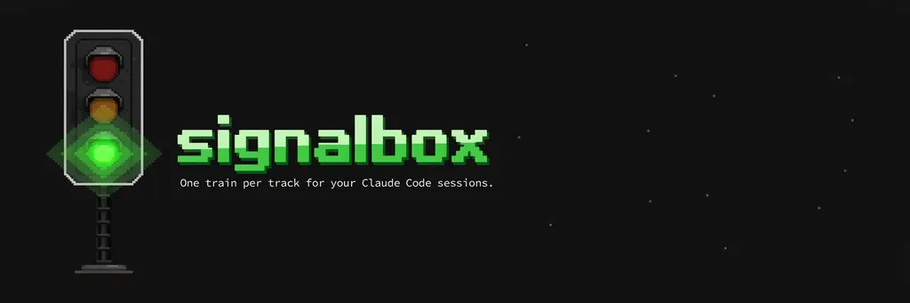

# signalbox



One train per track for your Claude Code sessions: signalbox lets several sessions work on
one repository at once, each in its own git worktree, without stepping on each other, and
merges their pull requests one at a time, each checked on the merged result.

> **Status: stable.** From 1.0.0, what [Compatibility](docs/commands.md#compatibility) lists changes only
> in a major release; the [changelog](CHANGELOG.md) says what each release brings.


## The problem it solves

Several Claude Code sessions working on one repository at once, each in its own git
worktree, collide in ways none of them can see from where it stands:

| Without signalbox | With signalbox |
| --- | --- |
| Two sessions change the same file, and each finds out at merge time. | Every session starts with the board's summary: which worktrees change files, which of them share files with it; before each prompt, what changed since the last one. |
| A pull request passes its checks alone, then breaks the base once merged next to another one. | The merge lane runs the repository's own gate on the result of merging the pull request with the current base, one at a time, and merges only the head it checked. |
| A session runs `gh pr merge` and skips every check of the merged result. | The merge guard tells it to use the lane. |
| Merged worktrees and branches pile up, and nobody knows which are safe to remove. | The sweep removes clean worktrees whose branch was merged, and merged branches, sparing whatever is still in use. |
| A change spans an API and the apps that call it, and each repository is merged on its own. | A group shows the other repositories in each brief and merges their pull requests in dependency order. |
| Nobody can tell whether working in parallel pays. | Flow metrics: merges, stale merges, lane waits and failures, merges outside the lane. |

It installs once with Homebrew, is set up once from a terminal interface, and links any
number of repositories, each with only the features it needs.

## Requirements

- macOS with [Homebrew](https://brew.sh).
- Python 3.11 or later. The Homebrew formula installs and uses Homebrew's Python 3.15.
- git 2.38 or later (the board reads conflicts with `git merge-tree --write-tree`). git is
  looked for in your `PATH`, then in Homebrew's folder.
- [GitHub CLI](https://cli.github.com) (`gh`), signed in (`gh auth login`), for the merge
  lane and for the pull-request data of the board and the metrics. The repository's
  `origin` must be on GitHub for the merge lane.
- Claude Code, installed on its own, for the session brief and the merge guard: they run as
  Claude Code hooks.

## Install

```sh
brew install alejandrovdev/signalbox/signalbox
signalbox --version
```

The tap is `alejandrovdev/signalbox`. Installing adds the `signalbox` command and nothing
else: no hook is installed and no repository is touched until you run `signalbox setup` and
`signalbox init`.

## Quick start

1. Set up this Mac once. It checks the prerequisites, chooses the features new projects
   start from, and installs the Claude Code hooks in `~/.claude/settings.json`:

   ```sh
   signalbox setup
   ```

2. Link a repository. Go to its folder (the main checkout or any of its worktrees) and run
   `init`:

   ```sh
   cd ~/Projects/shop
   signalbox init
   ```

3. Look at the board:

   ```sh
   signalbox status
   ```

   ```text
   # Board of shop

   ## Worktrees

   | Branch | Feature documents | Behind | Ahead | Changed files | Conflicts with origin/main | Hours since last commit | Pull request |
   | --- | --- | --- | --- | --- | --- | --- | --- |
   | main |  | 0 | 0 | 0 | no | 3 |  |
   | fix-checkout |  | 2 | 3 | 4 | no | 1 | #41 |
   | add-coupons | coupons | 0 | 5 | 7 | yes | 0 | #42 |

   ## Shared files

   | Branch | File | Also changed by |
   | --- | --- | --- |
   | fix-checkout | src/cart.ts | add-coupons |
   | add-coupons | src/cart.ts | fix-checkout |

   ## Merge lane

   Lock: free.

   | Started | Pull request | Status | Wait (s) | Gate (s) | Attempts |
   | --- | --- | --- | --- | --- | --- |
   | 2026-11-24T16:02:11Z | 40 | merged | 0 | 212 | 1 |
   ```

4. Merge a pull request through the lane:

   ```sh
   signalbox merge 42
   ```

   The gate's output streams while it runs. On success the last line is
   `lane: #42 merged: main <commit> holds the checked tree <tree>.`, followed by what the
   sweep removed.

From then on, every Claude Code session you start in a worktree of `shop` gets the brief,
is told what changed in the other worktrees before each prompt, and is sent to the lane when
it tries `gh pr merge`.

## Features and presets

| Feature | What you get | Needs |
| --- | --- | --- |
| `board` | `signalbox status`: what each worktree changes, behind and ahead, conflicts, shared files, the lane's lock and last runs | git 2.38+ |
| `session-brief` | The board's summary at session start, and the other worktrees' changes before each prompt | `board`, Claude Code |
| `merge-lane` | `signalbox merge <pr>`: one at a time, gated on the merged result, merged only if the head did not move | `gh` signed in, a gate, `origin` on GitHub |
| `merge-guard` | Sessions that try `gh pr merge` are told to use the lane | `merge-lane`, Claude Code |
| `sweep` | Merged, clean worktrees and merged local branches go away by themselves | git |
| `metrics` | `signalbox metrics`: lead time, lane waits and failures, merges outside the lane | `board`; `gh` for the pull-request section |

The presets are `minimal` (`board`, `sweep`) and `recommended` (all six). A project that
needs another set lists its features instead of naming a preset (`custom` in the screens is
simply your own checklist).

A feature that is off does nothing: its command refuses with the command that turns it on,
and its hooks stay silent.

```text
signalbox: The project "blog" does not have the merge-lane feature. Turn it on with: signalbox init ~/Projects/blog
```

## How it works


signalbox keeps no service running: each command, and each Claude Code hook, reads the
configuration file and git, does its work and ends. The board and the brief never fetch;
the merge lane fetches what it merges.

## Documentation

- [Commands](docs/commands.md): what `setup` and `init` ask, every command with its flags,
  the exit codes, how to uninstall, and what stays stable between releases.
- [Configuration](docs/configuration.md): the configuration file and its keys, the
  environment variables, and every file signalbox writes.
- [How signalbox works](docs/how-it-works.md): the merge lane step by step, the sweep's
  rules, what the hooks tell a session, the merge guard, the flow metrics, and repositories
  that depend on each other.
- [Troubleshooting](docs/troubleshooting.md): start with `signalbox doctor`, then the common
  cases.
- [Changelog](CHANGELOG.md): what each release brings.

## Uninstall

Remove the Claude Code hooks first: they run the installed command.

```sh
signalbox uninstall
brew uninstall signalbox
brew untap alejandrovdev/signalbox
```

`signalbox uninstall` keeps the configuration and the logs, and says where they are;
`--purge` removes them too. What each step leaves in place is in
[Uninstall](docs/commands.md#uninstall).

## Contributing

Bug reports and pull requests are welcome: see [CONTRIBUTING.md](CONTRIBUTING.md). Report a
vulnerability privately, as [SECURITY.md](SECURITY.md) says.

## License

signalbox is released under the [MIT License](LICENSE).
