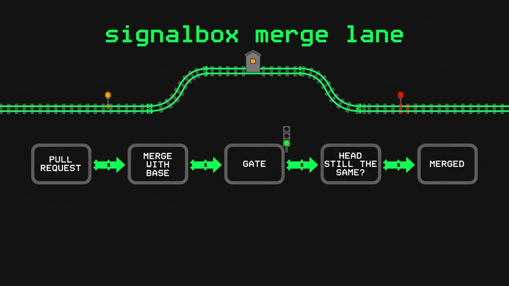
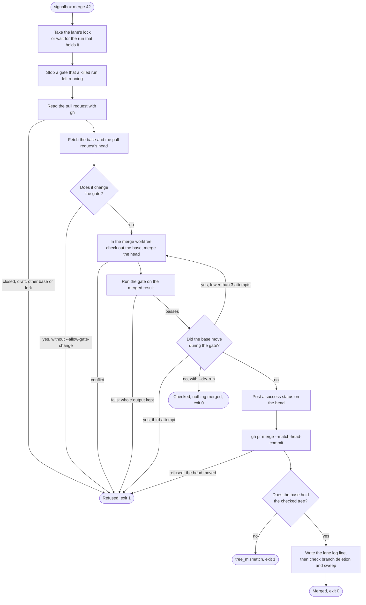

# How signalbox works

Part of [signalbox](../README.md). What the merge lane does step by step, how the sweep decides, what the hooks tell a session, what the merge guard refuses, how to read the flow metrics, and what a group of repositories that depend on each other adds.

## The merge lane



`signalbox merge <pr>` merges one pull request into the base, one run at a time per
repository, only after the project's gate passed on the result of merging it with the
current base: the tree GitHub then writes to the base. Your working tree, index and branch
are never touched: the lane merges in a worktree of its own.



Step by step:

1. **Lock.** The run takes the lane's lock, `signalbox-lane.lock` in the repository's git
   folder (shared by every worktree), and any `legacy_locks`. When another run holds it, it
   says `lane: another merge is running; #42 waits for its turn.` and waits. The lock goes
   with the process: however a run ends, the lock is free again.
2. **Leftovers.** A gate that a run killed with `SIGKILL` left running is stopped first.
3. **Read the pull request** with `gh pr view`. It is refused unless it is open, not a
   draft, based on the project's base, and from this repository (not a fork). Its head
   commit is read here and pinned: from now on, the lane checks and merges that commit.
4. **Fetch** the base and the head from `origin`. When the head commit is not there any
   more, the run stops: run it again.
5. **Gate-change check.** A pull request that changes the gate would check itself, so it is
   refused until you review that change and run again with `--allow-gate-change`. The gate
   is: the files its command names (`scripts/check.sh` in `sh scripts/check.sh`); the
   `Makefile` of a `make` gate; the `package.json` script of an `npm`, `pnpm` or `yarn` gate
   (`scripts.verify` for `pnpm verify`; another script of the file is no change to the gate),
   and the files that script names; and the files the project's `gate_files` patterns match.
6. **Merge** in the merge worktree: it checks out the current base, detached, and merges the
   head into it in a commit that is never pushed. A conflict refuses the pull request:
   update its branch with the base and run again.
7. **Gate.** The gate runs in the merge worktree on that merged result.
8. **Base moved?** When the base moved on `origin` while the gate ran, the lane starts again
   from step 6 on the new base: 3 attempts in all.
9. **Status.** The lane posts a commit status, `signalbox/merge-lane`, on the head: success
   with the checked tree, or failure with why. A dry run posts nothing.
10. **Merge on GitHub** with `gh pr merge <pr> --merge --match-head-commit <head>` (or
    `--squash`, `--rebase`, as `merge_method` says). A push after the check makes GitHub
    refuse it.
11. **Tree check.** After the merge, the lane fetches the base again: its tree must be the
    tree the gate checked. Otherwise the run ends as `tree_mismatch`.
12. **Cleanup.** The run's log line is written first, so an interrupted cleanup is still a
    merge. Then the lane warns when GitHub keeps merged branches (turn on "Automatically
    delete head branches" in the repository's settings) and, with the `sweep` feature,
    sweeps.

### The gate

The gate is any shell command (`/bin/sh -c "<gate>"`), run in the merge worktree with your
environment plus `gate_env`. It passes with exit code 0. Its output reaches you while it
runs. It runs in its own process group: when the lane is stopped, the gate is stopped too
(`SIGTERM`, then `SIGKILL` after 10 seconds).

The merge worktree is reset between runs without deleting ignored files, so installed
dependencies stay. A gate that needs dependencies can install them itself, for example
`pnpm install --frozen-lockfile && pnpm verify`. Inside the merge worktree, git runs
without your hooks and with an identity of its own (`merge lane`).

The merge worktree is detached, outside every checkout:
`~/Library/Caches/signalbox/<project>/merge.noindex` unless `merge_worktree` says
otherwise (`.noindex` keeps it out of Spotlight). It is made when missing, and made again
when a killed git left an `index.lock` in it. The lane resets and cleans only a worktree it
made itself (it marks it in its git folder): a `merge_worktree` that names a checkout, a
session's worktree or a folder with files in it is refused, and nothing in it is touched.

When the gate fails, its whole output is kept in

```text
~/Library/Logs/signalbox/<project>/gates/<YYYYMMDD-HHMMSS>-pr<number>-attempt<n>.log
```

(the date and time are in UTC), and the lane prints that path. With `gate_failed_step`, the
message names the step: `lane: #42 not merged: the gate failed at "unit tests".`

### The lane log

Each run that took the lock is one JSON line in
`~/Library/Logs/signalbox/<project>/lane.jsonl`. The log is best effort: a line that
cannot be written never changes the output or the exit code. The board shows the last three
runs and the metrics read them all.

| Field | What it holds |
| --- | --- |
| `version` | `1` |
| `startedAt` | when the run started, in UTC |
| `pullRequest` | the pull request's number |
| `head` | the head commit the run checked |
| `status` | how it ended (below) |
| `waitSeconds` | time spent waiting for the lock |
| `gateSeconds` | time spent in the gate, all attempts together |
| `durationSeconds` | the whole run |
| `attempts` | how many times the head was merged and gated |
| `baseTip` | the base commit of the last attempt |
| `tree` | the tree of the merged result the gate checked |
| `mergeCommit` | the commit GitHub wrote to the base |
| `failedStep` | the step `gate_failed_step` found, or `null` |
| `gateLog` | the file with a failed gate's whole output, or `null` |
| `group` | the group of a [group merge](#repositories-that-depend-on-each-other), or `null` |

| Status | Meaning | Exit code |
| --- | --- | --- |
| `merged` | merged, and the base holds the checked tree | 0 |
| `checked` | `--dry-run`: the gate passed, nothing merged | 0 |
| `refused` | not open, a draft, another base, from a fork, or `gh pr view` could not read it | 1 |
| `gate_changed` | it changes the gate; run again with `--allow-gate-change` after reviewing it | 1 |
| `conflict` | it conflicts with the base | 1 |
| `gate_failed` | the gate failed | 1 |
| `base_moved` | the base moved during each of 3 attempts | 1 |
| `merge_failed` | `gh pr merge` refused it, for example because the head moved after the check | 1 |
| `tree_mismatch` | merged, but the base's tree is not the checked one: look at the base now | 1 |
| `interrupted` | stopped by Ctrl-C or `SIGTERM` | 130 or 143 |
| `error` | git or the fetch failed, the head left its branch, or the merge worktree's folder holds something else | 1 |

## The sweep

The sweep removes the worktrees whose branch was merged into the base and deletes the merged
local branches no worktree holds. It runs:

- at every session start, detached in the background (the session-start hook), so a session
  never waits for it;
- after every merge through the lane;
- when you run `signalbox sweep` (`--dry-run` to see what it would do).

It never fetches: it reads `origin/<base>` as last fetched (the lane fetches before its
sweep).

**What counts as merged.** A branch whose tip `origin/<base>` reaches, or the head of a pull
request the lane merged (by squash or rebase, whose commits the base does not reach). A
worktree is looked at only when its branch's tip is also off the base's first-parent line: a
worktree just cut from the base is reachable too, and stays.

**Why a merged worktree stays.** Each kept worktree is reported with its reason:

| Reason | What it means |
| --- | --- |
| `the main checkout` | the repository's own folder is never removed |
| `it holds the caller's directory; a sweep run from elsewhere removes it` | you (or the shell that ran the sweep) are inside it |
| `a live Claude Code session stands in it (session <id>)` | a session that is still running last stood in it (see below) |
| `cannot tell whether a recorded session still runs (ps failed)` | `ps` could not be read |
| `uncommitted changes` | changed or untracked files (read with `--untracked-files=normal`, whatever your git settings say) |
| `files git is told not to check (skip-worktree or assume-unchanged)` | files marked with `git update-index --skip-worktree` or `--assume-unchanged`, whose edits `git status` does not show |
| `locked (<reason>)` | locked with `git worktree lock`. A Claude Code agent's lock (`claude agent <id> (pid <pid> start <date>)`) holds only while the agent runs: once no process with that pid and start date runs, or Claude Code's record says the agent finished in that very worktree, the lock is released and the worktree removed. |
| `ignored files that are not build output (<path>)` | an ignored file that `build_output` does not list |
| `used since its branch was merged` | its HEAD moved after the base received the branch: it was cut from a commit the base already held, or somebody checked out or committed in it since |
| `cannot tell when it was last used (no reflog)` | no reflog says when its HEAD last moved |
| `a process runs in it (pid <n>)` | a process has its current directory inside it |
| `cannot tell whether a process runs in it (lsof failed)` | `lsof` could not be read |
| `git worktree remove failed: <git's message>` | git refused (the sweep never uses `--force`) |

**Sessions.** Between two commands no process of a Claude Code session stands in its
worktree, so `lsof` alone cannot tell that a session still works there (for example one that
merged its own branch and goes on). The hooks record where each session stands: one small
file per session in `~/Library/Application Support/signalbox/sessions/`, with its current
directory and its `claude` process (found once per session, by its start date). While that
process runs, the worktree it last stood in stays; an idle session keeps it until it ends. A
sweep (not a dry run) removes the records of sessions that ended.

**Branches.** A merged local branch is deleted only when no worktree holds it, it is not the
base, it does not point at the base's tip (a branch just cut), and it is not the first branch
(`worktree-<agent>`) of a Claude Code agent that still runs, which may switch back to it. Its
remote-tracking ref (`origin/<branch>`) goes with it only when the base reaches that ref
too. **The sweep never deletes a branch on GitHub**: deleting it there closes the pull
requests based on it, while GitHub's "Automatically delete head branches" retargets them.

```text
sweep: removed worktree <path> (add-coupons, merged into origin/main)
sweep: kept worktree <path> (fix-checkout): uncommitted changes
sweep: deleted branch add-coupons (merged into origin/main)
```

A worktree whose branch is not merged is not reported. With nothing to do, it prints
`sweep: nothing to sweep.`

## The session brief and the hooks

`setup` installs three hooks in your user settings, `~/.claude/settings.json`, each running
`signalbox hook <event>` through the installed command:

| `signalbox hook` event | Claude Code event | Timeout | What it does |
| --- | --- | --- | --- |
| `session-start` | `SessionStart` | 15 s | With `session-brief`, prints the brief, which reaches the session. With `sweep`, starts a sweep in the background. |
| `user-prompt-submit` | `UserPromptSubmit` | 15 s | With `session-brief`, prints what changed in the other worktrees since the previous prompt. |
| `pre-tool-use` | `PreToolUse`, for `Bash` | 10 s | With `merge-guard`, refuses a direct merge (see [the merge guard](#the-merge-guard)). |

Every other setting and hook of the file is kept as it was; `uninstall` takes out only
these three.

**Silent outside a linked repository.** A hook reads Claude Code's JSON on standard input
and looks at its `cwd`. When that folder is in no linked project, or the project does not
have the feature, it prints nothing and exits with 0. Whatever fails, it exits with 0: a hook
never blocks a session by failing. The only other exit is the guard's refusal (2).

User-level hooks, rather than hooks in the repository, because a repository's untracked
`.claude/settings.local.json` is missing from every new worktree, and hooks in its tracked
`.claude/settings.json` load from each worktree's own copy, so a branch cut before they were
added lacks them.

**The brief** (`signalbox brief` prints it) holds, in at most 2,000 characters:

```text
This worktree: fix-checkout, 2 behind origin/main, no conflict with origin/main.
Other worktrees that change files:
- add-coupons; features: coupons; shares: src/cart.ts
Merge with signalbox merge <number>. While you work run the focused checks; the lane runs the gate (make check).
```

The worktrees that share files with this one come first, with at most five shared files
each. The last line appears only with `merge-lane`.

**Before each prompt** (`signalbox changes` prints it), the session hears only what is new
since the previous prompt in this worktree: that its branch now conflicts with the base, or
that a file it changes is now also changed by another branch (at most 10 lines). The first
run records the state and says nothing. Like the board, the brief and the changes read git
only and never fetch.

### Hooks for a team

`signalbox init --shared-hooks` also writes the same three hooks into the repository's
`.claude/settings.json`, as `signalbox hook <event> --shared`, found through each person's
`PATH`. Commit that file so the team gets them. Everyone who works in the repository then
needs signalbox installed and the repository linked; a teammate without signalbox gets a
failing hook.

The two sets never run twice: a `--shared` hook does nothing when the person's own
user-level hooks are installed, so a person who ran `setup` is served by their own hooks
only.

## The merge guard

With `merge-guard`, the `pre-tool-use` hook reads each command a session is about to run in
Bash and refuses a merge that skips the lane. The session is told:

```text
Merge through the lane: signalbox merge 42. A direct gh pr merge skips the check of the merged result.
```

What it refuses:

- `gh pr merge`, also with `gh`'s own `-R` or `--repo` before `pr`;
- a call to GitHub's API with `PUT` on `pulls/<number>/merge`, through `gh api`, `curl` or
  `wget`;
- either one after `&&`, `;`, `|`, a newline, `env` or variable assignments, `timeout`, or
  inside `bash -c '...'`.

What passes: the same words inside a quoted argument (a commit message, a search pattern, an
`echo`), `gh pr merge --help`, and a `GET` of `pulls/<number>/merge`, which only asks.

**It is guidance, not a security boundary.** It reads commands as the shell splits them and
cannot run them, so `xargs`, `eval`, a GraphQL mutation, a `gh` alias or an interpreter
(`python3 -c`, `node -e`) get around it. It sees only the commands of Claude Code sessions
in a linked repository: a merge from GitHub's website or from your own terminal is not seen.
The metrics count such merges as `Outside the merge lane`. A hook that refuses (exit 2)
stops the call in every permission mode.

## Flow metrics

`signalbox metrics` measures how work reaches the base while several sessions work at once,
over a window of local days (by default the last 14 days, up to now). It reads the merges on
the base's first-parent line, the pull requests GitHub merged (through `gh`), the lane's log
and the worktrees open now. No model is called and nothing is fetched: the base is read as
last fetched, so `git fetch` first for fresh numbers. The output is Markdown with these
sections (`--json` gives the same as one object; a measure with nothing to measure is
`n/a` there and `null` in JSON):

- **Window**: the start and end, in UTC.
- **Merges**: what landed on the base's first-parent line in the window, following the
  project's `merge_method`: with `merge`, each merge commit; with `squash`, each commit GitHub
  wrote (committer `noreply@github.com`) or the lane recorded; with `rebase`, each run of
  consecutive commits GitHub wrote with one committer time (a rebased pull request), named by
  its newest commit. A commit pushed straight to the base is never a merge; an edit made on
  GitHub's website straight on the base is written by GitHub too, and counts as one.
  - `Total`, and a table of merges per day.
  - `Stale`: merges of a branch that did not hold the base's previous tip, so the result
    was never tested as such by the branch's own checks. `Stale share` is their part of the
    total; `most commits behind`, how far the worst one was.
  - `Stale with files changed on both sides`: stale merges where the base and the branch
    changed the same file, with the files that did so most often: where a branch that passed
    its own checks can still break the base.
  - `Documentation only`: merges that changed only Markdown, files under `docs/`, or feature
    documents.
  - `Within 2 minutes of the previous one`: merges that landed right after another, on a
    base the other had just changed.
  - `Outside the merge lane`: merge commits the lane did not make (merged on GitHub or from
    a terminal).

  With `squash` and `rebase`, `Stale` and `Stale with files changed on both sides` cannot be
  measured (a landing keeps no second parent): the section says so, and the JSON has
  `"method"` and `null` there. For a rebase run, `Documentation only` reads the whole run.
- **Pull requests**: how many GitHub merged in the window (from the latest 500), and the
  minutes from open to merge: median, 90th percentile and maximum. This is the lead time.
  With `--no-github`, or without `gh`, it says it was not measured.
- **Merge lane**: runs that started in the window; the wait for the lock (median, 90th
  percentile), which grows when sessions queue to merge; the gate's time on merged runs; the
  most attempts one run needed, which grows when the base moves fast; runs by status; the
  steps that failed most (with `gate_failed_step`); and log lines that could not be read.
- **Live**: every worktree now, behind the base, changed files and whether it conflicts; how
  many conflict, and the files changed in two or more worktrees, where the next collision is
  likely.

Percentiles use the nearest rank. `--until` excludes the day it names. The days follow your
Mac's time zone, or the `TZ` variable.

## Repositories that depend on each other

One change often spans several repositories: a field the API adds and the app shows. Link
each repository as its own project (each with its base and gate), then name them in a
[`[groups.<name>]`](configuration.md#groupsname) table, in dependency order. The group adds three things.

**The brief reaches across the group.** After this repository's lines, a session also reads
`Other repositories of <group>:` and one line per worktree of the other repositories that
changes files (`- api: add-coupons; features: coupons`), each measured against its own
project's base, git only. A repository of the group that cannot be read is left out. Within
the brief's 2,000 characters this repository's lines come first: the group's are cut first.

**One board for the group.** `signalbox status --group` prints the board of every project of
the group, in order (`--json`: `{"group": ..., "projects": [{"project": ..., ...}]}`; a
project that cannot be read is named, and the exit code is 1).

**A merge in order.** Name the pull requests of the change, a bare number for this folder's
repository and `<project>#<number>` for the others:

```sh
signalbox merge 25 api#27
```

```text
group: merging in order: api#27, web#25; what merges stays merged if a later one fails.
...
group: api#27 merged
group: web#25 merged
```

Every pull request is read first: when any would be refused (closed, a draft, on another
base, from a fork, unreadable, or changing its own gate without `--allow-gate-change`), each
is named and nothing runs. Then the lanes run one after
another in the group's order (not the command line's), each in its own repository with its
own lock, gate and lane log (its record says `"group"`), and the run stops at the first that
does not merge: the closing lines say `merged`, `not merged (<status>)` or `not tried`. The
exit code is 0 only when all merged. `--dry-run` and `--allow-gate-change` apply to each.

What it cannot do: merge atomically across repositories. What merged stays merged when a
later pull request fails its gate; fix that one and run its merge again. A dry run checks
each repository against its own base, which does not hold the earlier repositories' change.
Put options before or after the pull requests, not between them.
